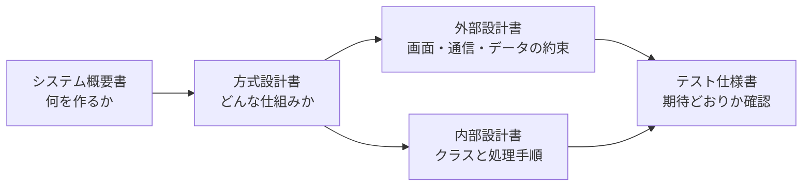

# IoTシステム開発実習 — 設計資料

> **設計上の完成形**を記述しています。配布版には `TODO` のままの箇所があります。実装は担当Issue・テスト仕様書に従って進めてください。

## 資料の見取り図

| 文書 | ここに書く | ここには書かない |
|---|---|---|
| [システム概要書](システム概要書.md) | 利用目的・利用者・できること・対象外 | クラス・SQL・JSON項目 |
| [方式設計書](方式設計書.md) | 構成方針・非同期化・Repository切替・例外方針 | APIの全項目・処理の細かな手順 |
| [ソースファイル構成・依存関係](ソースファイル構成・依存関係.md) | ファイルごとの役割・接続・Task別の未完成箇所 | 処理の詳細な手順 |
| [REST API外部設計](外部設計/REST_API.md) | リクエスト・レスポンス・HTTP状態 | Java内部実装 |
| [MQTT外部設計](外部設計/MQTTメッセージ.md) | Topic・QoS・JSONの内容 | コールバック・Executorの実装 |
| [データ保存外部設計](外部設計/データ保存形式.md) | 共通項目・DB表・CSVレコード | JDBC・CSV読書きの実装手順 |
| [Web画面外部設計](外部設計/Web画面.md) | 入力欄・表示内容・操作結果 | DOM操作関数の中身 |
| [MQTT内部設計](内部設計/MQTT受信.md) | `SensorPipeline`・`MqttReceiver` の手順 | MQTTペイロード定義 |
| [Repository内部設計](内部設計/Repository.md) | 各Repository・Producerのメソッドと分岐 | DB列定義の再掲 |
| [Service・REST内部設計](内部設計/Service_REST.md) | Service・Resource・Mapperの呼出し | APIのJSON仕様全文 |
| [Web内部設計](内部設計/Web.md) | JavaScriptモジュール・描画・例外処理 | 画面項目の定義全文 |

## 担当別の参照先

| 担当範囲 | 最初に読む資料 | 実装時に読む資料 |
|---|---|---|
| MQTT受信 | [方式設計書](方式設計書.md#3-mqtt受信非同期保存方式) §2～3 | [MQTT外部](外部設計/MQTTメッセージ.md) → [MQTT内部](内部設計/MQTT受信.md) |
| Repository / JDBC | [方式設計書](方式設計書.md) §2, §4 | [データ保存外部](外部設計/データ保存形式.md) → [Repository内部](内部設計/Repository.md) |
| Service・保存切替 | [方式設計書](方式設計書.md) §2, §4 | [MQTT外部](外部設計/MQTTメッセージ.md) → [Repository内部](内部設計/Repository.md) → [Service・REST内部](内部設計/Service_REST.md) |
| REST API | [方式設計書](方式設計書.md) §2, §5～6 | [REST外部](外部設計/REST_API.md) → [Service・REST内部](内部設計/Service_REST.md) |
| Web画面 | [方式設計書](方式設計書.md#5-rest-apiweb画面方式) §5 | [Web画面外部](外部設計/Web画面.md) → [Web内部](内部設計/Web.md) |

## 開発時の使い方

- **設計書**：共通の約束。変更するときはIssue/PRで確認し、関係する文書も直す。
- **[テスト仕様書](../tests/README.md)**：期待結果を記載。テストを実行するたびの結果・ログは原則Issue/PRに記録する。
- **GitHub操作**：[GitHubチーム開発 運用ルール・操作手順](../GitHubチーム開発_運用ルール・操作手順.md)を参照する。
- **Javadoc**：各クラスの細かなAPIは配布版に含まれる[完成版のJavaDoc](../apidocs/index.html)も参照する。

## 配布版と完成版の違い（重要）

| 項目 | 配布版 | 完成版の設計上の動作 |
|---|---|---|
| `RepositoryProducer` | CSV版を固定で返す | 設定 `CSV` / `JDBC` に応じて選択 |
| CSV Repository | 実装済み | 同じ形式で動作 |
| 共通検証・JDBC・Service・REST・MQTT・Web JS | 一部未実装 | 各内部設計書・外部設計書の動作を実装 |
| MQTT有効化 | 初期値は無効 | `APP_MQTT_ENABLED=true` で起動時に購読 |

> **注意**：CSV固定の配布版では `APP_STORAGE_TYPE=JDBC` を指定しても、保存方式切替の実装が終わるまでCSVが使用されます。実行環境の設定方法は[開発環境・動作確認](../開発環境・動作確認.md#3-環境変数)。

## テスト

- [テスト仕様書・実施方針](../tests/README.md)
