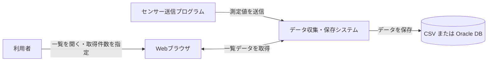
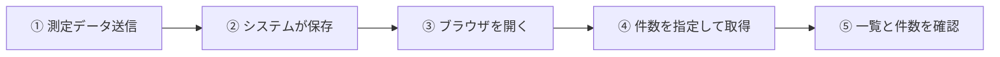

# システム概要書

> **何を作るか**をまとめた文書。採用する技術の理由は[方式設計書](方式設計書.md)、通信・データ項目の詳細は[外部設計書](README.md#資料の見取り図)へ。

## 1. 目的

**MQTTで届いたセンサー測定データを保存し、Webブラウザで新しいデータから一覧表示できるシステムを作る。**

## 2. 利用者と構成

| 利用者・外部要素 | やること |
|---|---|
| センサー送信プログラム | 測定値と日時を送る |
| 閲覧する利用者 | 取得件数を指定して一覧を見る |
| 訓練生 | 担当する機能を実装・テストする |

## 3. 機能一覧

| ID | 機能 | 完成条件の概要 |
|---|---|---|
| F-01 | センサーデータの受信 | MQTTメッセージを受け取る |
| F-02 | データ保存 | 受信データをCSVまたはOracle DBに保存する |
| F-03 | データ取得 | 保存済みデータを測定日時の新しい順で取得する |
| F-04 | Web一覧表示 | 指定した件数以内のデータ・取得件数を表示する |
| F-05 | エラー表示 | API通信等に失敗したことを画面に表示する |
| F-06 | 設定切替 | MQTT受信の有効・無効、CSV/JDBCを切り替える |

## 4. 利用イメージ

## 5. 対象範囲

| 今回作る | 今回作らない |
|---|---|
| センサーデータの受信・保存・最新順参照 | センサー機器の登録・変更・削除 |
| 取得件数の指定と一覧画面 | 期間・場所・センサー種別などによる絞り込み |
| CSV/JDBCの切替 | 認証・利用者管理 |
| 基本的なエラー表示 | 再送保証・負荷対策・冗長化 |

## 6. 仕様を調べる場所

| 確認したいこと | 参照先 |
|---|---|
| 通信や内部の役割分担 | [方式設計書](方式設計書.md) |
| MQTTで送る項目 | [MQTT外部設計](外部設計/MQTTメッセージ.md) |
| 保存されるデータ | [データ保存外部設計](外部設計/データ保存形式.md) |
| ブラウザ画面・REST要求 | [Web画面外部設計](外部設計/Web画面.md) / [REST API外部設計](外部設計/REST_API.md) |
