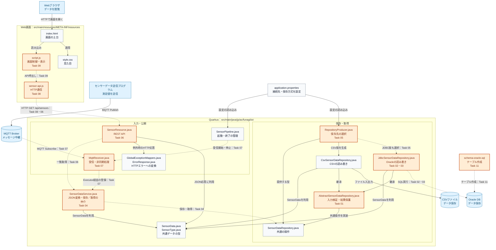

# ソースファイル構成・依存関係

> **目的：** 完成版の構成と、配布版でこれから実装する箇所を1枚の図で把握する。
>
> **凡例：** 白色＝配布版で役割が実装済み、橙色＝配布版で一部または全部が未実装。**実線＝配布版でも利用できる接続、破線＝完成版ではつながるが配布版では動作が未完成の接続**。破線はJavaの参照自体が存在しないという意味ではない。
>
> 図中の **Task番号** は教材内の作業番号であり、GitHubで自動採番されるIssue番号とは異なる。

## 全体図

**注意：** `SensorPipeline.java` の起動イベント処理は配布版に実装済みですが、呼び出し先の `MqttReceiver.java` が未完成のため、受信開始～保存までの経路を破線にしています。同様に、`SensorResource.java` にはJavaメソッドの宣言があってもRESTエンドポイントとしての公開設定が未完成です。

## 未完成部分と作業の対応

| Task | 対象ファイル | 完成するとつながる処理 |
|---|---|---|
| 01 | `AbstractSensorDataRepository.java` | 保存前の検証・取得結果の保護 |
| 02・03 | `JdbcSensorDataRepository.java` | RepositoryとOracle DB間の登録・取得 |
| 04 | `SensorDataService.java` | MQTT側の登録、REST側の取得とRepositoryとの接続 |
| 05 | `RepositoryProducer.java` | 保存先設定によるCSV／JDBCの選択 |
| 06 | `SensorResource.java` | HTTP GETによるREST API公開・Service呼出し |
| 07 | `MqttReceiver.java` | Brokerとの接続・購読、受信後の非同期登録 |
| 08 | `sensor-api.js` | Web画面からのHTTP通信 |
| 09 | `script.js` | データ取得処理の呼出しと一覧・メッセージの表示 |
| 11 | `schema-oracle.sql` | Oracle DB上のテーブル作成 |

Task 10：全体結合・受入確認 は、図中の経路が完成した後に、実際のBroker・Oracle DB・ブラウザを使用して確かめる作業です。

## 図を読むときのポイント

- **受信ルート：** 送信プログラム → Broker → `MqttReceiver` → `SensorDataService` → Repository → CSV／Oracle DB
- **表示ルート：** ブラウザ → `script.js` → `sensor-api.js` → HTTP → `SensorResource` → `SensorDataService` → Repository → JSON応答
- **保存先：** `RepositoryProducer` がCSV版とJDBC版の**いずれか一方**を提供します。完成版でも両方へ同時保存するわけではありません。
- **共通データ：** `SensorData` と `SensorType` は複数のクラスから使用されます。煩雑にならないよう、図では主要な利用関係のみ示しています。
- **テスト：** JUnit／Mockitoのテストソースは、この図では省略しています（アプリケーションの実行時構成を示すため）。
