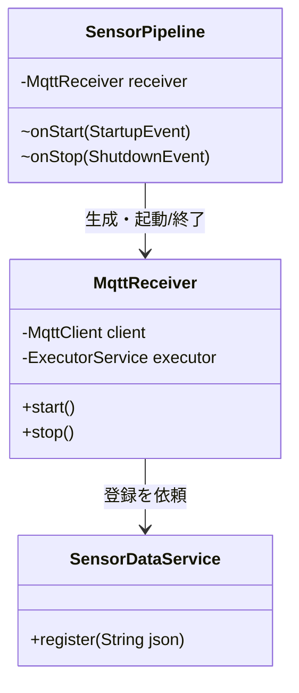
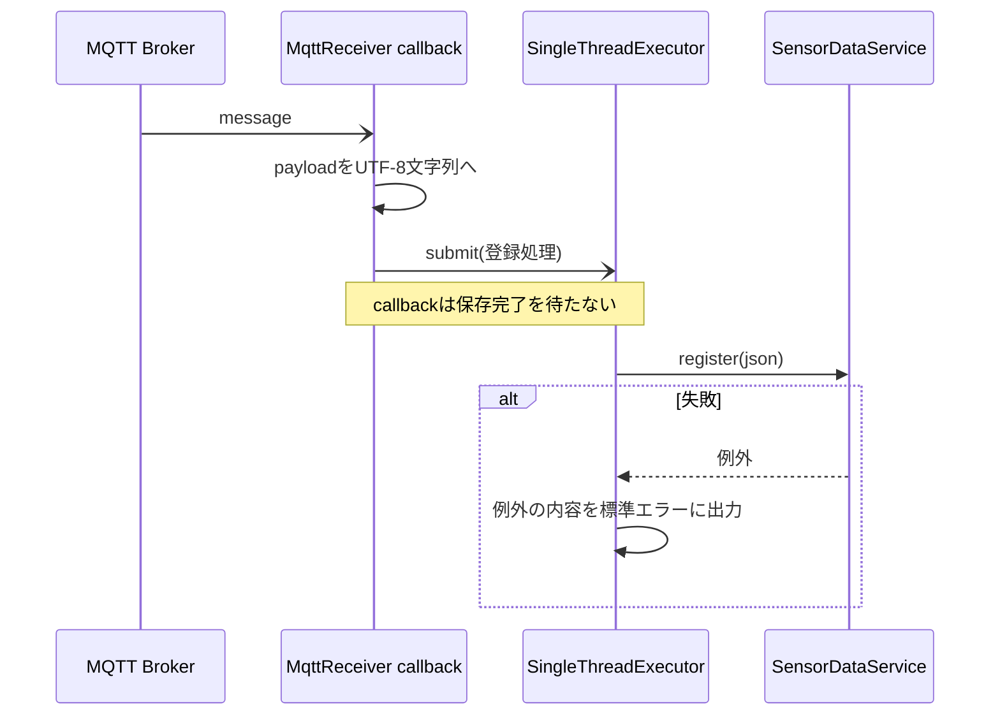

# MQTT受信 内部設計書

> **クラスがどう処理するか**。Topic・QoS・JSON項目の定義は[MQTT外部設計](../外部設計/MQTTメッセージ.md)。

## 1. クラスと役割

| メソッド | 役割 |
|---|---|
| `SensorPipeline.onStart()` | MQTT有効時のみ `MqttReceiver` を生成・起動 |
| `SensorPipeline.onStop()` | 受信を停止（MQTT無効時は何もしない） |
| `MqttReceiver.start()` | Executor生成 → Broker接続 → Topic購読 |
| `MqttReceiver.stop()` | MQTT切断・クローズ → Executor `shutdown()` |

※`SensorDataService`については、[Service・REST 内部設計書](Service_REST.md)を参照

## 2. 保存処理の受け渡し

## 3. 実装上の注意

| 項目 | 設計 |
|---|---|
| MQTTライブラリ | Eclipse Paho `MqttClient` |
| 非同期処理 | `Executors.newSingleThreadExecutor()`（1件ずつ順番に登録） |
| メッセージ受信 | Pahoの `subscribe(topic, qos, listener)` |
| 例外 | ワーカー内で `Exception` を捕捉。次の処理へ進める（受信スレッドの中断を防止） |
| 起動失敗 | `start()` 内で停止処理を試し、例外を再送出。`SensorPipeline` が起動失敗として扱う |
| 終了 | Broker切断・client.close後、Executorをshutdown。完了待ちはしない |

**対象外**：自動再接続、永続キュー、再送、停止直前のデータの保存保証。

**対応ファイル**：`mqtt/MqttReceiver.java`、`runtime/SensorPipeline.java`。
