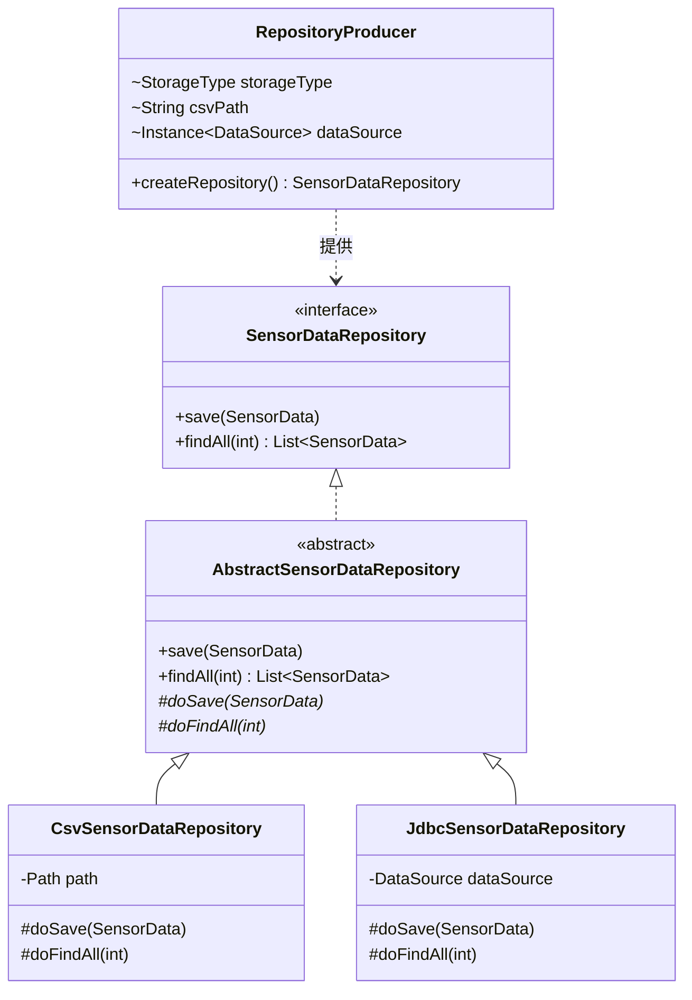
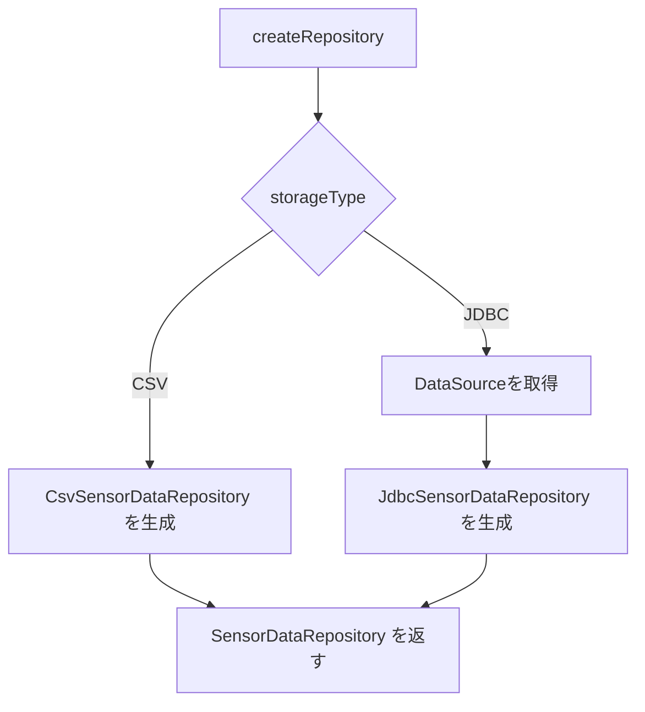
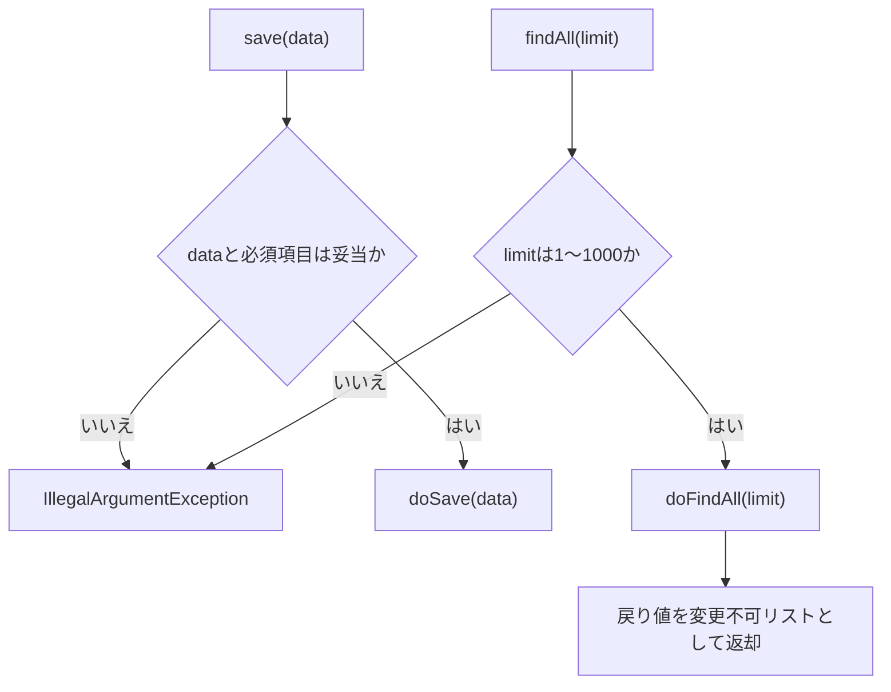

# Repository 内部設計書

> **クラス構造と処理手順**。DB列・CSV列・データ型の定義は[データ保存形式外部設計](../外部設計/データ保存形式.md)。

## 1. クラス関係

## 2. 保存先の生成

**RepositoryProducer.createRepository()の役割**
- `@Produces`により`SensorDataRepository`を依存元へ注入する。
- 保存方式（`app.storage.type`）の設定値に応じて、下記の処理を行う。

| 保存方式 | 処理 |
|---|---|
| CSV | CSVパス（`app.csv.path`）の設定値を使用して`CsvSensorDataRepository`を生成 |
| JDBC | `Instance<DataSource>.get()`で必要時に取得した`DataSource`を使用して`JdbcSensorDataRepository`を生成 |

## 3. 共通処理（AbstractSensorDataRepository）

| メソッド | 役割 |
|---|---|
| `save(data)` | `data`と`data.sensorId`、`data.sensorType`、`data.unit`、`data.measuredAt` を検証する（`data.sensorId` と `data.unit` は空白も不可）。検証に問題がなければ、`doSave(data)`を実行する。 |
| `findAll(limit)` | `limit`を検証する。検証に問題がなければ、`doFindAll(limit)`を実行し、その戻り値を`List.copyOf()`で変更不可リストに変換して返却する。 |
| `doSave(data)` | `data`を保存する。具体的な保存処理は、保存方式毎の具象クラスへ委任する。 |
| `doFindAll(limit)` | 最大`limit`件のデータを取得する。具体的な取得処理は、保存方式毎の具象クラスへ委任する。 |

## 4. CSV入出力

| メソッド | 手順 |
|---|---|
| コンストラクタ | 親ディレクトリとファイルがなければ作成 |
| `doSave` | 5項目の1行を組み立て → UTF-8で末尾追記 |
| `doFindAll` | 全行読込 → 空行を無視 → 5項目に分割・型変換 → リスト逆転 → 測定日時で安定ソート（降順） → 件数制限 |
| 同時アクセス | `synchronized` で読書きの重なりを防ぐ |
| 例外 | 入出力・CSV形式エラーを `RepositoryException` に包む |

「リスト逆転→安定ソート」は、**同じ測定日時なら後から追記した行を先にする**ため。

## 5. JDBC入出力

| メソッド | 手順 |
|---|---|
| コンストラクタ | `DataSource` を保持 |
| `doSave` | 接続取得 → データ登録用のSQL組み立て → SQL実行 |
| `doFindAll` | 接続取得 → データ取得用のSQL組み立て → SQL実行 → 取得したデータを1件ずつ `SensorData` に変換し、リストとして返却 |
| リソース管理 | `try-with-resources` で `Connection` / `PreparedStatement` / `ResultSet` を解放 |
| 例外 | `SQLException` を `RepositoryException` に包む |

**SQLインジェクション対策**：SQLの組み立てには`PreparedStatement`を使用する。
