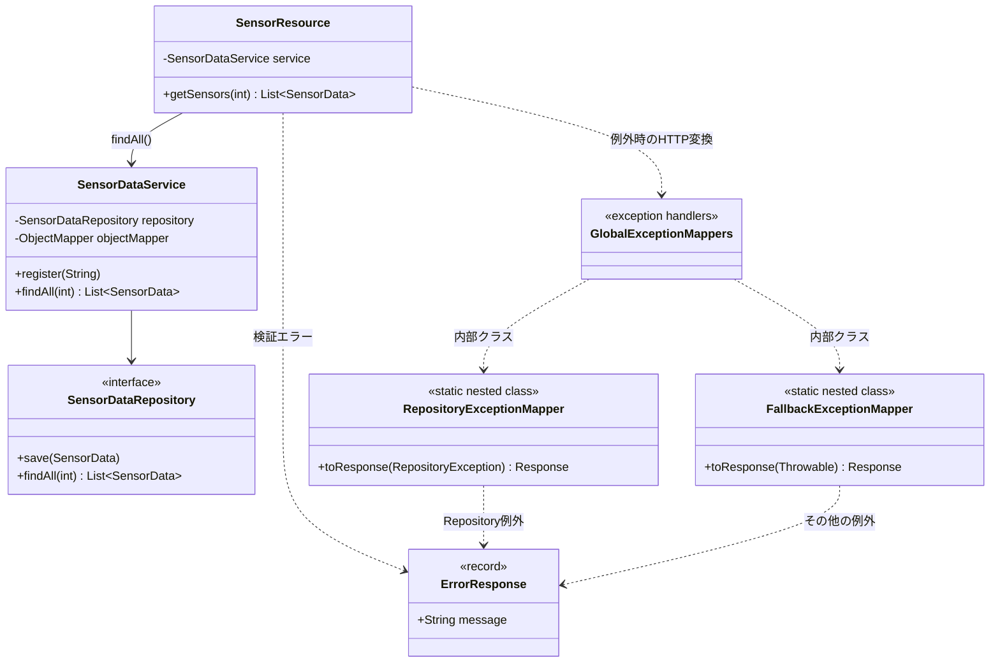
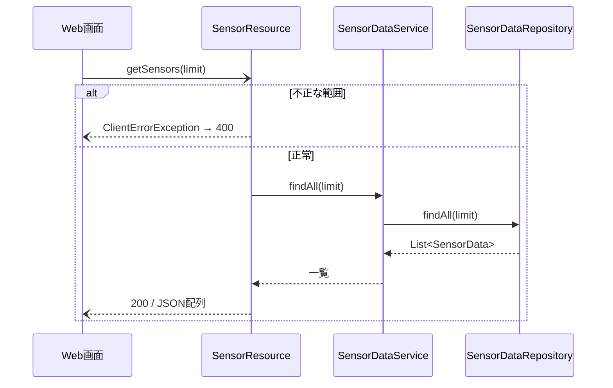

# Service・REST 内部設計書

> **処理の呼出し方**を定義。HTTPの入力・出力仕様は[REST API外部設計](../外部設計/REST_API.md)。MQTTのJSON項目は[MQTT外部設計](../外部設計/MQTTメッセージ.md)。

## 1. クラスの関係

## 2. メソッドの役割

| クラス・メソッド | 手順・役割 |
|---|---|
| `SensorDataService.register(String)` | `objectMapper` でJSONデシリアライズ（`SensorData`） → `repository` でデータ保存 |
| `SensorDataService.findAll(int)` | `repository` でデータを取得して返却 |
| `SensorResource.getSensors(int)` | 1～1000の範囲を検証 → `service` でデータを取得して返却 ※検証エラー時はHTTP 400、`ErrorResponse`をペイロードとする応答を`ClientErrorException`に詰めて投げる |
| `RepositoryExceptionMapper.toResponse` | `RepositoryException` をHTTP 500の応答に変換して返却 |
| `FallbackExceptionMapper.toResponse` | `WebApplicationException` の応答はそのまま返却、それ以外はHTTP 500の応答に変換して返却 |

## 3. REST取得の流れ

## 4. 例外処理の分担

| 発生位置 | 処理 |
|---|---|
| MQTTのJSON解析 | `SensorDataService.register()` から `IOException`（または変換エラー）を送出し、保存スレッドで捕捉・標準エラー出力 |
| RESTのlimit範囲外 | `SensorResource` がHTTP 400を構成 |
| Repositoryの入出力失敗 | `RepositoryException` をMapperがHTTP 500に変換 |
| その他の例外 | MapperがHTTP 500へ変換 |
