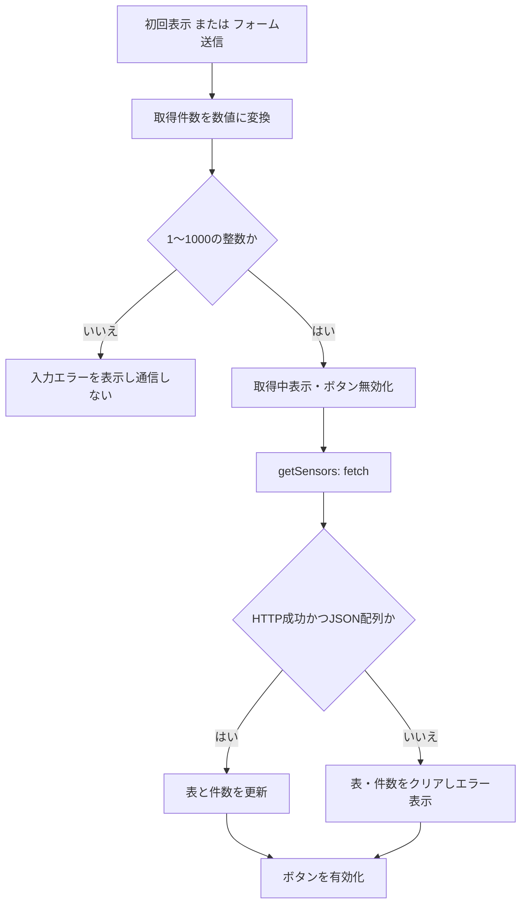

# Web画面 内部設計書

> **JavaScriptの処理構造**を定義。画面に何を表示するかは[Web画面外部設計](../外部設計/Web画面.md)、通信の戻り値は[REST API外部設計](../外部設計/REST_API.md)。

## 1. ファイルの役割

| ファイル | 役割 |
|---|---|
| `index.html` | 取得件数フォーム・メッセージ・件数・表 |
| `script.js` | 入力検証、ロード中表示、件数・表の更新、エラー通知 |
| `sensor-api.js` | `fetch`、HTTPステータス・JSON配列チェック |
| `style.css` | レイアウト・表示スタイル・レスポンシブ対応 |

## 2. 取得操作の流れ

## 3. 主要な関数

| 関数 | 手順 |
|---|---|
| `getSensors(limit)` | GET → `response.ok` を検証 → JSON配列であることを確認 → 返却 |
| `loadSensors()` | 値検証 → ボタン無効 → API呼出し → 成功/失敗表示 → finallyで有効化 |
| `displaySensors(sensors)` | 表を消去 → 配列を行に変換 → 0件なら「データはありません。」 |
| `addCellRow(values)` | `<tr>`・`<td>` を生成 → `textContent` で値を設定 |
| `showMessage(text,isError)` | メッセージ文字列とCSSクラスを更新 |

- `form` の `submit` を `preventDefault()` してページ再読み込みを防ぐ。
- 初回表示時は `loadSensors()` を呼ぶ。
- データ値をHTMLとして挿入せず、`textContent` で表示する。
