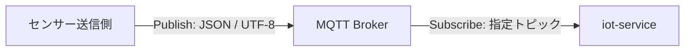

# MQTTメッセージ外部設計書

> **外部との約束**：Publishするメッセージ形式と購読先を定義する。受信スレッドの動きは[MQTT内部設計](../内部設計/MQTT受信.md)。

## 1. 通信仕様



| 項目 | 内容 | 備考 |
|---|---|---|
| Broker URL | `tcp://192.168.11.6:1883` | 環境変数: `MQTT_BROKER_URL` |
| Topic | `iot/sensor` | 環境変数: `MQTT_TOPIC` |
| QoS | `1` | 環境変数: `MQTT_QOS` |
| Client ID | `iot-service` | 環境変数: `MQTT_CLIENT_ID` |
| ペイロード | UTF-8のJSONオブジェクト1件 | |

## 2. ペイロード

データ項目と値の制約は**[データ保存形式外部設計](データ保存形式.md) §1**を共通定義とする。

```json
{
  "sensorId": "TMP01",
  "sensorType": "TEMPERATURE",
  "value": 23.5,
  "unit": "C",
  "measuredAt": "2026-11-19T10:30:00"
}
```

| 注意事項 | 内容 |
|---|---|
| `sensorType` | 大文字の列挙値を使用する |
| `measuredAt` | タイムゾーン情報のないローカル日時文字列 |
| メッセージ単位 | 1メッセージ = 1件の測定データ |
| 欠損・形式不正 | 保存できず、受信側でエラー出力する。送信元に保存成功通知は返さない |

> QoS 1はMQTT配送の設定であり、DB/CSVへの**重複なし保存や保存成功を保証するものではない**。
