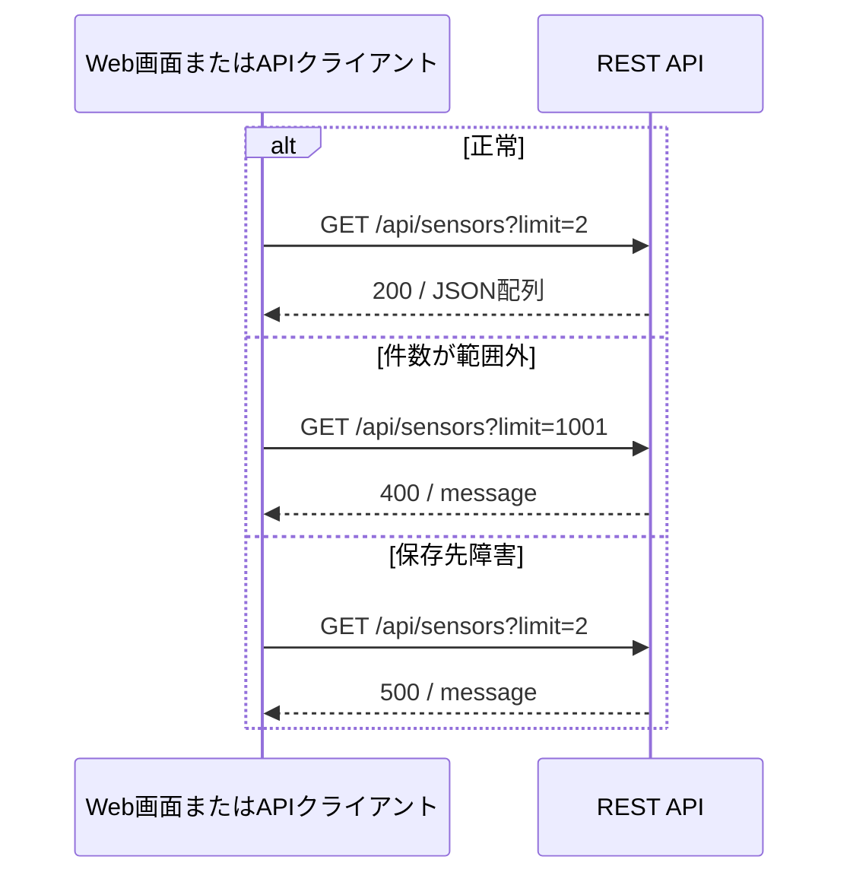

# REST API 外部設計書

> **外部との約束**：クライアントが送るHTTP要求と、返されるデータを定義する。Java側の呼出しは[Service・REST内部設計](../内部設計/Service_REST.md)。

## 1. エンドポイント

| 項目 | 仕様 |
|---|---|
| 用途 | 保存済みの測定データ一覧を取得 |
| HTTPメソッド | `GET` |
| URL | `/api/sensors` |
| クエリ | `limit`（整数、1～1000、省略時100） |
| Content-Type（正常応答） | `application/json` |
| 戻り値 | 測定データの配列。最大`limit`件。0件なら `[]` |
| 並び順 | `measuredAt`（測定日時）の降順。同一日時のデータは登録順が後のものを優先 |

## 2. リクエスト・レスポンス例

```http
GET /api/sensors?limit=2
```

**正常：HTTP 200**

```json
[
  {
    "sensorId": "TMP01",
    "sensorType": "TEMPERATURE",
    "value": 23.5,
    "unit": "C",
    "measuredAt": "2026-11-19T10:30:00"
  }
]
```

各フィールドの詳細は[データ保存形式](データ保存形式.md) §1を参照。`measuredAt`の表記はJSONシリアライズ設定に従い、秒の表示は日付値や設定によって異なり得る。

## 3. 応答パターン

| 条件 | HTTP | 応答 |
|---|---|---|
| 正常（データあり） | `200` | JSON配列 |
| 正常（データなし） | `200` | `[]` |
| `limit=0` または `limit=1001` | `400` | 下記エラーオブジェクト |
| CSV/DBのアクセス失敗 | `500` | 下記エラーオブジェクト |
| その他の予期しない内部エラー | `500` | 下記エラーオブジェクト |

**エラー形式（アプリケーションが生成するエラー）**

```json
{ "message": "limitは1から1000の範囲で指定してください" }
```

| 条件 | `message` |
|---|---|
| 件数が範囲外 | `limitは1から1000の範囲で指定してください` |
| 保存先障害 | `データアクセス時にエラーが発生しました` |
| その他の内部エラー | `予期しないエラーが発生しました` |

> **注意**：`limit=abc` のような「整数へ変換できない入力」はHTTPフレームワーク側で処理されるため、上記と同じJSON形式・文言を必ず返すという仕様にはしない。画面側でも事前に入力を検証する。

## 4. 呼出しイメージ


