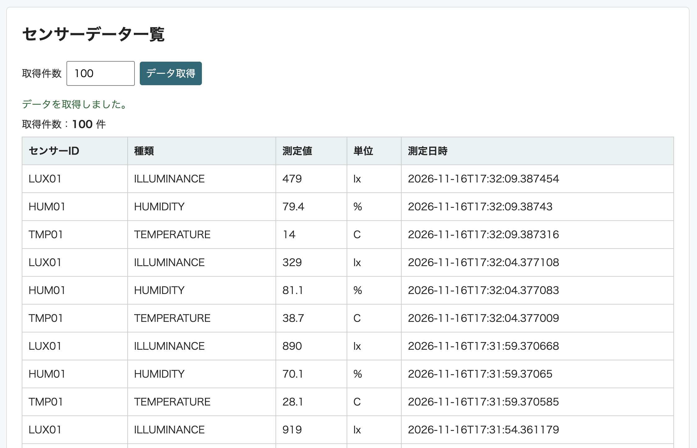
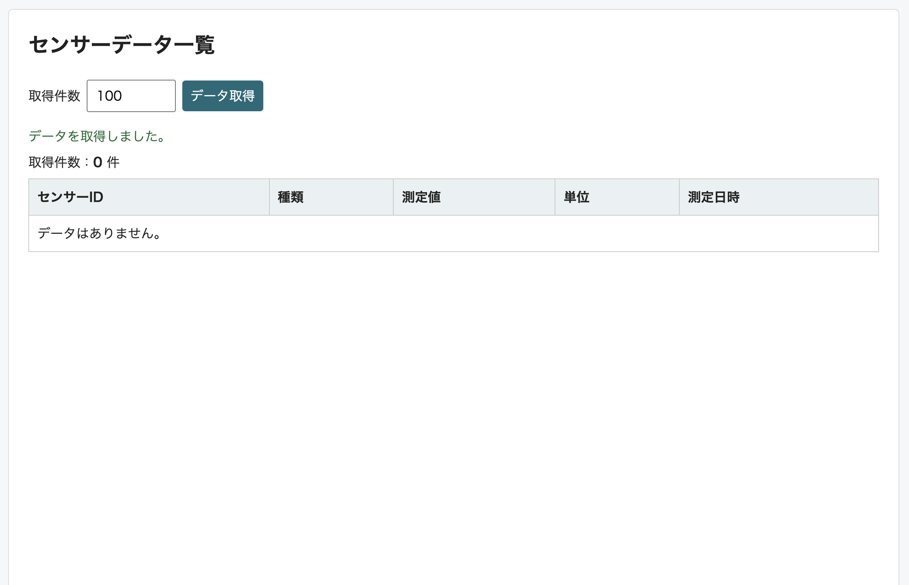
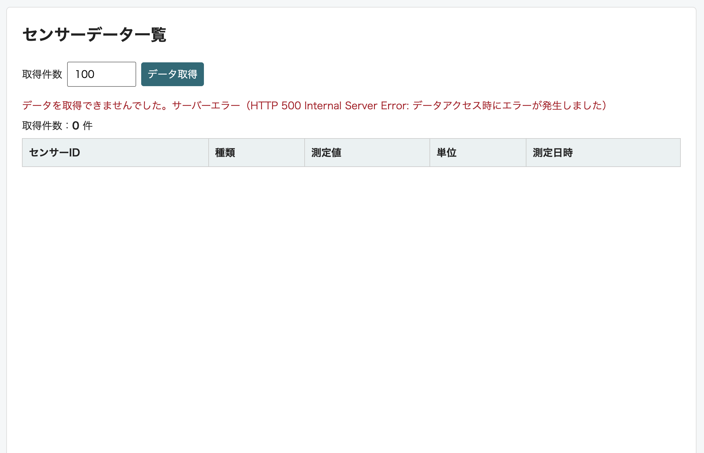
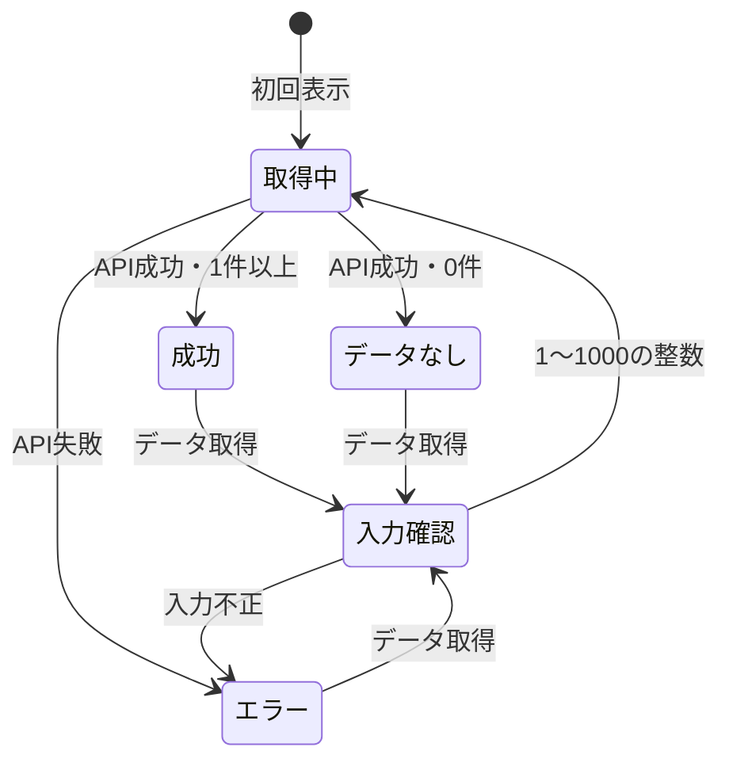

# Web画面 外部設計書

> **利用者が見るもの**：入力欄、表示項目、操作したときの結果を定義。JavaScript実装は[Web内部設計](../内部設計/Web.md)。

## 1. 画面レイアウト

**データ複数件**

**データ0件**

**API応答エラー**

## 2. 入力・表示項目

| 項目 | 種類 | I/O | 仕様 |
|---|---|---|---|
| 取得件数 | 数値入力 | I | 初期値100、整数1～1000、必須 |
| データ取得 | ボタン | I | 押すとAPIから取得。取得中は無効 |
| メッセージ | テキスト | O | 取得中・成功・失敗・入力不正を通知 |
| 取得件数 | テキスト | O | APIから取得した配列の長さ |
| センサーデータ一覧 | テーブル | O | データの型・意味は[データ保存形式](データ保存形式.md) §1を参照 |
| &nbsp;&nbsp;&nbsp;&nbsp;センサーID | テキスト | O | |
| &nbsp;&nbsp;&nbsp;&nbsp;種類 | テキスト | O | |
| &nbsp;&nbsp;&nbsp;&nbsp;測定値 | テキスト | O | |
| &nbsp;&nbsp;&nbsp;&nbsp;単位 | テキスト | O | |
| &nbsp;&nbsp;&nbsp;&nbsp;測定日時 | テキスト | O | |

## 3. 操作・表示の変化

| 状況 | 画面の動作 |
|---|---|
| 初回表示 | 初期値100件で自動取得を実行する |
| 取得中 | データ取得ボタンを無効化する メッセージに「データを取得しています。」を表示する |
| 取得終了 | データ取得ボタンを有効化する |
| 取得成功 | センサーテータ一覧、取得件数の表示内容を更新する メッセージに「データを取得しました。」を表示する |
| 0件 | 取得件数を更新する センサーテータ一覧に「データはありません。」を表示する メッセージに「データを取得しました。」を表示する |
| 入力不正 | メッセージに「取得件数は1～1000の整数で入力してください。」を表示する |
| API/通信失敗 | 取得件数を更新する センサーテータ一覧の表示をクリアする メッセージに「データを取得できませんでした。」とAPIから応答されたエラーメッセージを表示する |

画面幅が狭い場合も内容を参照できるよう、**最低限のレスポンシブ対応**を行う。見た目の詳細はCSSで調整する。
