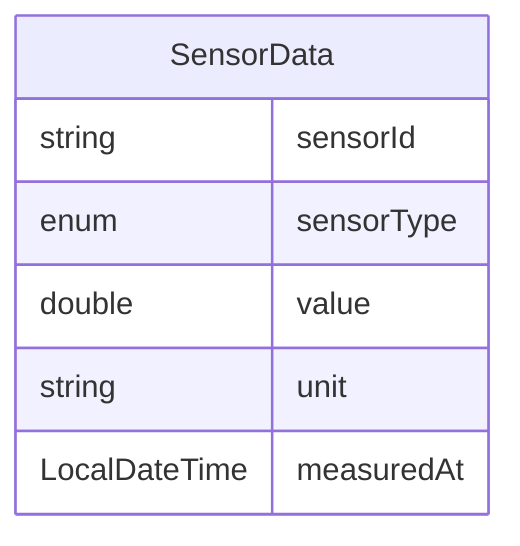
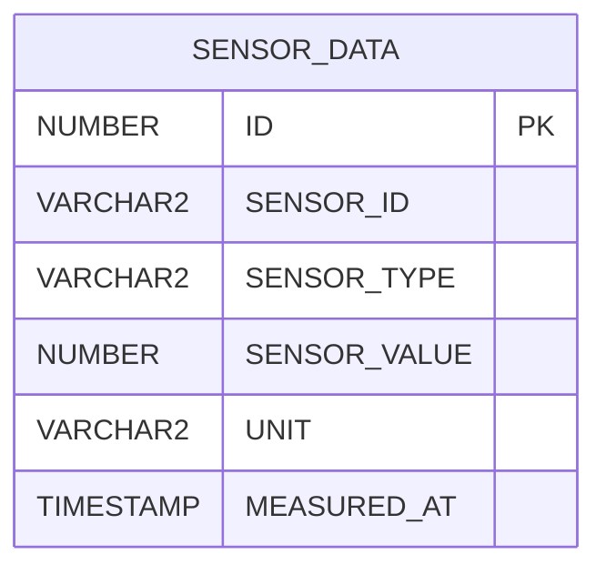

# データ保存形式 外部設計書

> **データの約束**：MQTT・REST・CSV・DBで共通に扱う測定データの項目を定義する。読書き手順は[Repository内部設計](../内部設計/Repository.md)。

## 1. 共通の測定データ



| JSON/Javaの名前 | データ型 | 必須・値の条件 | 例 |
|---|---|---|---|
| `sensorId` | 文字列 | null・空白不可 | `TMP01` |
| `sensorType` | 列挙値 | `TEMPERATURE` / `HUMIDITY` / `ILLUMINANCE` | `TEMPERATURE` |
| `value` | 数値 | `double`（特別な測定値範囲チェックなし） | `23.5` |
| `unit` | 文字列 | null・空白不可 | `C` |
| `measuredAt` | 日時文字列 | null不可。例はISO形式 | `2026-11-19T10:30:00` |

## 2. Oracle DB



**テーブル名**：`SENSOR_DATA`

| 列 | Oracle型 | 条件 | 対応項目 |
|---|---|---|---|
| `ID` | `NUMBER` | IDENTITY、主キー | DB内の登録順序を識別 |
| `SENSOR_ID` | `VARCHAR2(50)` | NOT NULL | `sensorId` |
| `SENSOR_TYPE` | `VARCHAR2(30)` | NOT NULL | `sensorType` |
| `SENSOR_VALUE` | `NUMBER(14,4)` | NOT NULL | `value` |
| `UNIT` | `VARCHAR2(20)` | NOT NULL | `unit` |
| `MEASURED_AT` | `TIMESTAMP` | NOT NULL | `measuredAt` |

## 3. CSV

**文字コード**：UTF-8、1行1件、ヘッダーなし。保存先のパスは `APP_CSV_PATH`（初期値 `./sensor-data.csv`）。

| 列順 | 内容 | 例 |
|---|---|---|
| 1 | `sensorId` | `TMP01` |
| 2 | `sensorType` | `TEMPERATURE` |
| 3 | `value` | `23.5` |
| 4 | `unit` | `C` |
| 5 | `measuredAt` | `2026-11-19T10:30:15` |

```text
TMP01,TEMPERATURE,23.5,C,2026-11-19T10:30:15
HUM01,HUMIDITY,56.0,%,2026-11-19T10:31:15
```

**簡易仕様**：項目内にカンマ・改行を含めない。引用符・エスケープ処理は行わない。
