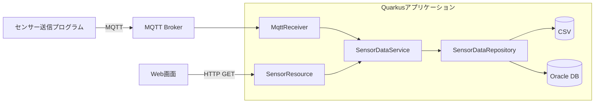
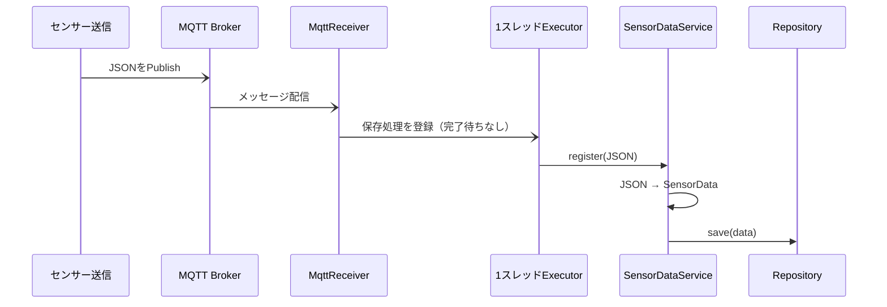
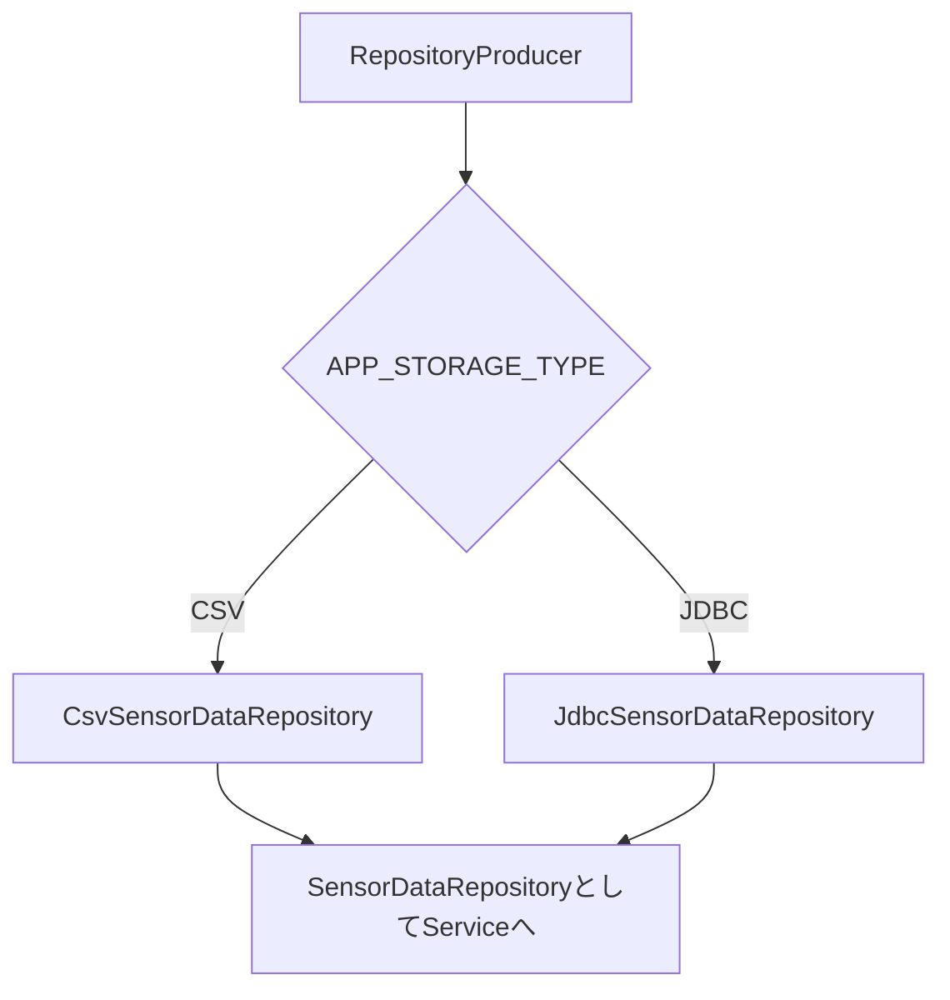
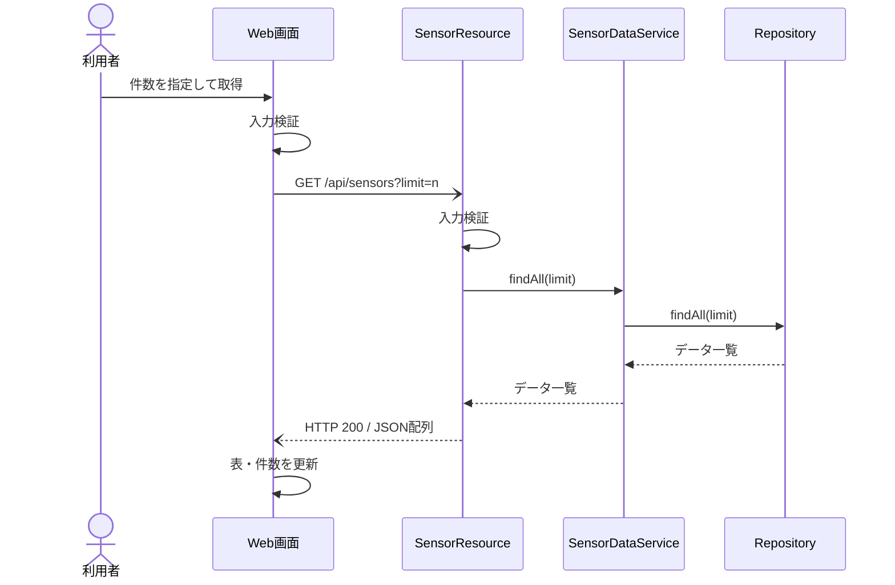
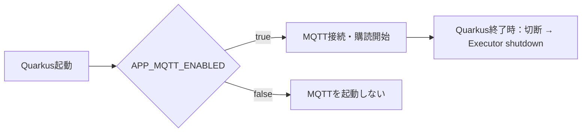

# 方式設計書

> **どのような仕組みで実現するか**を示す。システムの目的は[概要書](システム概要書.md)、入出力項目は[外部設計](外部設計)、メソッド手順は[内部設計](内部設計)。

## 1. 設計方針

| 方針 | 採用する方式 | 理由 |
|---|---|---|
| データを集める | MQTTで受信 | センサーから継続的にデータを受け取る |
| データを見せる | REST API＋Web画面 | データ収集と画面表示を分離する |
| 処理を分担する | Resource / Service / Repository | 担当別に実装・テストできる |
| 保存処理を切り離す | 1スレッドのExecutor | MQTT受信コールバックを長時間占有しない |
| 保存先を選ぶ | CSV / JDBCを設定で切替 | DB未接続でも段階的に確認できる |

## 2. システム・アプリケーション構成

CSVとOracle DBは**いずれか一方**を使用する。BrokerとOracle DBは訓練用サーバー、Quarkusは開発PCなどで動作させる想定。

> ファイル単位の役割、完成版での依存関係、配布版で未完成の接続とTask番号は、[ソースファイル構成・依存関係](ソースファイル構成・依存関係.md)を参照する。

| 層 | 主なクラス | 役割 |
|---|---|---|
| 入力 | `MqttReceiver` / `SensorResource` | MQTT受信・HTTP要求受付 |
| 業務処理 | `SensorDataService` | JSON変換・保存・取得の窓口 |
| データアクセス | `SensorDataRepository` | 保存・取得を共通操作にする |
| 保存先選択 | `RepositoryProducer` | CSV/JDBC実装の提供 |

**ルール**：入口のクラスから直接SQLやCSVを操作しない。

## 3. MQTT受信・非同期保存方式

| 受信側 | 保存側 |
|---|---|
| JSONをUTF-8文字列として受け取り、Executorに渡す | JSON解析 → Repository保存。例外は標準エラーへ出力 |

**制約**：Executorの内部キューに上限は設定せず、再送保証も行わない。受信したことは保存成功を意味しない。

## 4. データ保存・取得方式

- CSVはUTF-8の追記式、JDBCは `PreparedStatement` でOracle DBを操作する。
- `AbstractSensorDataRepository` が入力チェックと取得結果の保護を共通化する。
- 取得順は**測定日時の降順**。同じ日時は**後に登録したデータを優先**する。
- **配布版**の `RepositoryProducer` はCSV固定。切替処理の実装は訓練生の課題。

## 5. REST API・Web画面方式

- ブラウザからは `fetch()` でREST APIを呼ぶ。取得中はボタンを無効化する。
- Web側とREST側の両方で件数を検証する。具体的な範囲・応答は[REST API外部設計](外部設計/REST_API.md)。
- 受信文字列の表示には `textContent` を使用する。

## 6. 共通方式

### 6.1 エラー処理

| 経路 | 対応 |
|---|---|
| Web | 入力不正・通信失敗を画面に通知 |
| REST | 不正な件数はHTTP 400、保存先障害などはHTTP 500 |
| MQTT | 保存スレッドで例外を記録。HTTP応答は返さない |

### 6.2 起動・終了

初期値は `APP_MQTT_ENABLED=false`。終了時は未処理データが残り得る（全件保存保証なし）。

### 6.3 設定管理

`application.properties`が環境変数から設定を取得する。MQTT受信の有効化、CSV/JDBC切り替え、接続先等を実行環境ごとに指定する。

- MQTTのクライアントIDは、同時起動するPC間で重複させない。
- DBパスワードなどの秘密情報をGitに登録しない。
- 設定項目とEclipseでの指定方法は[開発環境・動作確認](../開発環境・動作確認.md#3-環境変数)を参照する。

> クラスごとの処理は[内部設計](内部設計)を参照する。
