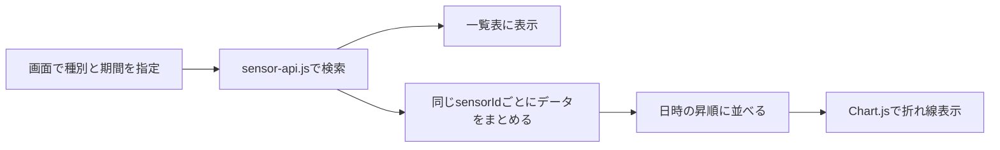

# 折れ線グラフの設計（基本表示・種別切替・期間指定・表示改善）

> **作業名の確認：** [タスク早見表](../タスク早見表.md)（D0・B1・A1などの記号と担当機能の対応）

## 方針

- **折れ線のみ**。Chart.jsをWebリソースとしてプロジェクト内に同梱し、CDNに依存しない。
- 既存の`GET /api/sensors`の検索結果を使用し、グラフ専用の検索APIは設けない。
- センサー種別検索（B1）と測定日時範囲検索（B2）のAPIをグラフ表示にも利用する。センサーIDを利用者が入力するUIは追加しない。
- X軸：測定日時（ローカル日時の文字列をラベルとして利用）、Y軸：測定値。測定日時の昇順に並べ替える。
- **異なるセンサーIDの測定値を一本の線に混ぜず、同一種別内ではセンサーIDごとに別系列を描く。**凡例にIDを表示することはあるが、検索入力には使わない。
- 最初は温度を表示対象とし、その後グラフ種別切替（A2）で温度・湿度・照度の種別切替を可能にする。0件は「データなし」。単位の異なる値は同じ軸へ混在させない。

## 段階

| Task | UI機能 | 前提 | 単独での完成条件 |
|---|---|---|---|
| 基本折れ線グラフ（A1） | 基本の折れ線 | 測定日時範囲検索（B2） | `sensorType=TEMPERATURE`で得たデータを系列別に線で表示、0件の表示あり |
| グラフ種別切替（A2） | センサー種別切替 | 基本折れ線グラフ（A1） | 利用者の種別選択に従って検索APIを再取得・再描画 |
| グラフの測定期間指定（A3） | 測定期間指定 | グラフ種別切替（A2） | `from`/`to`を指定し、期間内のデータにグラフを更新 |
| 表とグラフの表示改善（A4） | 表・グラフの表示改善 | グラフの測定期間指定（A3） | 一覧とグラフの表示切替・併記、共通エラー・ローディング表示 |

## ソース変更案

| ファイル | 責務 |
|---|---|
| `META-INF/resources/vendor/chart.umd.min.js` | 基本折れ線グラフ（A1）で固定バージョンのChart.jsを同梱 |
| `META-INF/resources/vendor/LICENSE-chartjs.txt` | ライブラリのライセンス情報 |
| `META-INF/resources/js/graph.js`（新規） | データ整形、センサーID別の系列構築、折れ線生成・更新・破棄。HTTP通信しない |
| `META-INF/resources/js/sensor-api.js` | センサー種別検索（B1）・測定日時範囲検索（B2）で完成した検索API呼出しを再利用 |
| `META-INF/resources/js/script.js` | 画面操作、API呼出し、表・グラフ更新を調整 |
| `META-INF/resources/index.html` | `<canvas>`および種別・日時入力欄 |

## 表示の流れ

## テストと割り切り

- 1件、複数件、0件、種別・期間を変更したケースをブラウザで確認。
- 複数センサーが同じ時刻に測定しなくても、誤って1本の線につながない。
- 複数センサーの測定時刻が異なる場合は、X軸を日時順にした共通ラベルとし、存在しない測定点には値を入れない簡易実装とする。時間軸用の追加アダプタ導入は不要。
- 同一センサーID内でも種別が異なる場合は、種別を分ける。グラフ種別は一度に1つだけ選ぶ。
- API側の`limit`が最大1000件なので、最新1000件の範囲のグラフであることを明記する。データ集計・補完はしない。
