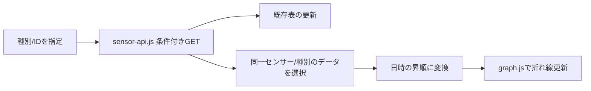

# A1～A4：折れ線グラフ表示（外部・内部設計）

## 全体方針

- `GET /api/sensors`の検索結果を使い、**新しいグラフ専用APIは設けない**。
- Chart.jsをローカルに同梱する。CDN依存にしない。バージョン・LICENSEは実装時に固定し、同梱する（資料作成段階ではファイル未配置）。
- **折れ線のみ**。横軸＝測定日時、縦軸＝測定値。描画データは日時の昇順に並び替える。
- 初期状態では**1つのsensorId × 1つのsensorType**を1系列として表示する。温度と湿度の値や単位を同じ軸へ混在させない。
- Chart.js利用のための追加ビルドツールは導入せず、既存の静的リソースとして配布する。

## 段階の定義

| 段階 | 機能 | 最小完成条件 |
|---|---|---|
| A1 | 基本グラフ | 既存の検索APIから取得した最新の1センサーID・1種別を自動選択し、折れ線で表示。0件時は空表示。 |
| A2 | センサー種別の選択 | 利用者がTEMPERATURE／HUMIDITY／ILLUMINANCEのいずれかを指定し、APIを再取得してグラフを更新。 |
| A3 | センサーIDの選択 | 利用者がsensorIdを指定してAPIを再取得し、1センサー×1種別を表示。 |
| A4 | 一覧との併記・切替 | 表とグラフを見やすく併記、または表示切替。データ取得状態とエラー表示を共用。 |

A1～A3は**B1/B2完成を前提**とする。A1はグラフの描画部分だけを最小限に実装し、既存APIの結果から同一系列に属する要素を抽出する。A2/A3では検索APIへ選択した条件を送るため、JavaScript側の重複フィルターは増やさない。

## ソースの変更案

| ファイル | 責任 |
|---|---|
| `META-INF/resources/js/graph.js`（新規） | Chart.jsインスタンス生成・更新・破棄、データ整形のみ。HTTP通信はしない。 |
| `META-INF/resources/js/sensor-api.js` | 既存B1/B2の条件付き取得を利用。 |
| `META-INF/resources/js/script.js` | 入力値・API呼出し・一覧とグラフの更新をまとめる。 |
| `META-INF/resources/index.html` | `<canvas id="sensor-chart">`と種別・ID選択欄。 |
| `META-INF/resources/vendor/chart.umd.min.js` | Chart.js配布ファイル（実装時に同梱）。 |
| `META-INF/resources/vendor/LICENSE-chartjs.txt` | 配布ライセンス（実装時に同梱）。 |

## 擬似データ処理の流れ

## テスト観点

- A1：1系列で測定時刻順、0件なら空表示、同じ単位の測定値だけをプロット。
- A2：種別変更時にリクエストパラメータが変わり、グラフも更新。
- A3：ID変更時に該当センサーの測定値のみ表示。
- A4：表とグラフで取得結果が一致。通信失敗時にどちらも古い結果を誤表示しない。

JavaScriptはブラウザ手動試験を基本とする。Java側は既存B機能のJUnitを再実行する。
