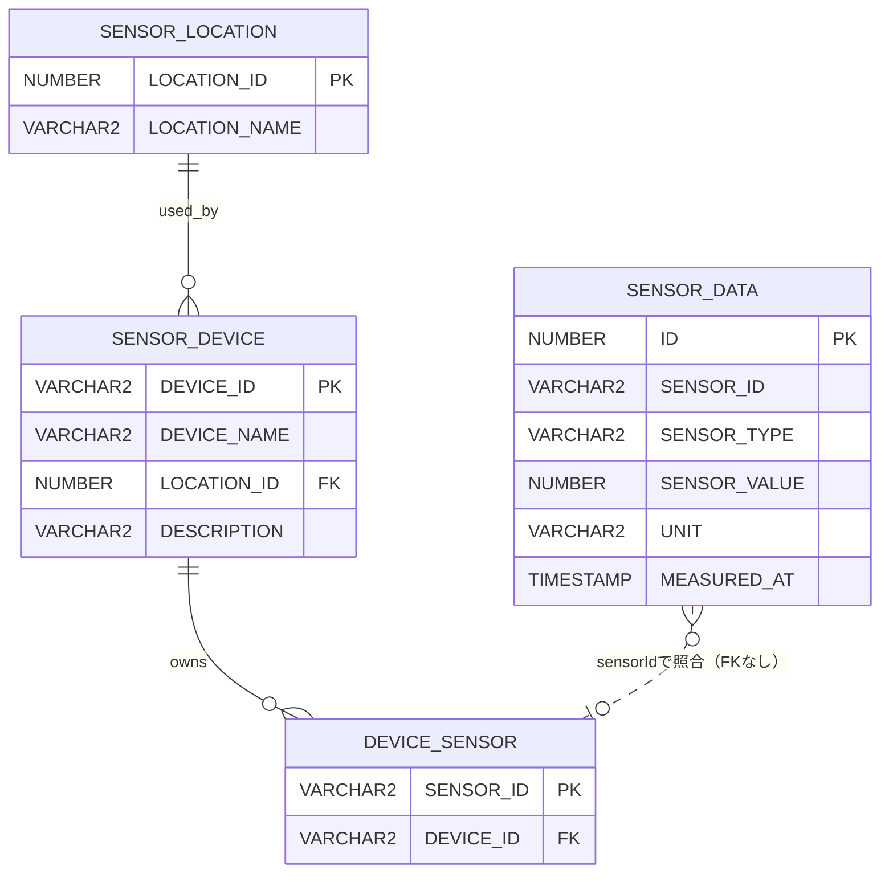

# C1～C5：IoTデバイス管理（外部・内部設計）

## 独立性

C1～C4はセンサーデータの収集・検索と**独立して利用できる機能**。C1で`SENSOR_LOCATION`と`SENSOR_DEVICE`を一緒に作り、登録・一覧の画面まで完成させる。C5で初めてデバイスとセンサーIDを対応付ける。

## DB設計（Oracle）



### C1で追加するDDL案

```sql
CREATE TABLE SENSOR_LOCATION (
    LOCATION_ID NUMBER GENERATED BY DEFAULT AS IDENTITY PRIMARY KEY,
    LOCATION_NAME VARCHAR2(100) NOT NULL UNIQUE
);

CREATE TABLE SENSOR_DEVICE (
    DEVICE_ID VARCHAR2(50) PRIMARY KEY,
    DEVICE_NAME VARCHAR2(100) NOT NULL,
    LOCATION_ID NUMBER NOT NULL REFERENCES SENSOR_LOCATION(LOCATION_ID),
    DESCRIPTION VARCHAR2(300)
);

INSERT INTO SENSOR_LOCATION (LOCATION_NAME) VALUES ('実習室A');
INSERT INTO SENSOR_LOCATION (LOCATION_NAME) VALUES ('実習室B');
COMMIT;
```

訓練環境に合わせて場所名は変更可。場所マスタの編集画面は作成しない。初期値はSQLで提供する。

### C5で追加するDDL案

```sql
CREATE TABLE DEVICE_SENSOR (
    SENSOR_ID VARCHAR2(50) PRIMARY KEY,
    DEVICE_ID VARCHAR2(50) NOT NULL REFERENCES SENSOR_DEVICE(DEVICE_ID)
);
```

`DEVICE_SENSOR`は**sensorIdが主キー**。同じセンサーIDが複数デバイスへ重複割当てされることを防ぎ、1デバイスに複数センサーIDを割り当てられる。`SENSOR_DATA`へ外部キーを追加しない（送信順や未登録センサーの受信を妨げない）。

## REST API（提案）

| 段階 | メソッドとURL | 入力 | 応答 |
|---|---|---|---|
| C1 | `GET /api/locations` | なし | `[{locationId,locationName}]` |
| C1 | `GET /api/devices` | なし | `[{deviceId,deviceName,locationId,locationName,description}]` |
| C1 | `POST /api/devices` | `{deviceId,deviceName,locationId,description}` | 201、作成した情報 |
| C2 | `GET /api/devices/{deviceId}` | URLのID | 200、1件／404 |
| C3 | `PUT /api/devices/{deviceId}` | `{deviceName,locationId,description}` | 200、更新後の情報 |
| C4 | `DELETE /api/devices/{deviceId}` | URLのID | 204／404 |
| C5 | `GET /api/devices/{deviceId}/sensors` | URLのID | 割当済みセンサーID一覧 |
| C5 | `POST /api/devices/{deviceId}/sensors` | `{sensorId}` | 201、登録した割当 |
| C5 | `DELETE /api/devices/{deviceId}/sensors/{sensorId}` | URLの2種のID | 204／404 |

C5の測定データ表示は、`GET /api/devices/{deviceId}/sensors`で取得した**各sensorId**を、B2の`GET /api/sensors?sensorId=...`に渡して実現する。デバイスIDをsensorIdの代わりに渡してはいけない。

## C1～C5の画面と完成条件

| 段階 | 画面 | 実際に使える機能 |
|---|---|---|
| C1 | `devices.html`とJavaScript | デバイスID・名称・場所・説明を登録し、一覧を表示する。場所は`SENSOR_LOCATION`から選択する。 |
| C2 | デバイス一覧から詳細へ | 選択した1台のID・名称・設置場所・説明を閲覧する。 |
| C3 | 詳細画面から編集 | 名称・場所・説明を変更でき、詳細へ反映される。IDは変更不可。 |
| C4 | 詳細画面から削除 | 確認後に削除し、一覧から消える。 |
| C5 | 詳細に「関連センサー」欄 | センサーIDを登録／解除し、IDごとの測定データを見られる。 |

## 新規ソース案

| レイヤー | ファイル例 | 責任 |
|---|---|---|
| model | `SensorDevice.java`（record） | `deviceId, deviceName, locationId, locationName, description`を保持 |
| model | `SensorLocation.java`（record） | `locationId, locationName`を保持 |
| model | `DeviceSensor.java`（record、C5） | `deviceId, sensorId`の対応 |
| repository | `SensorDeviceRepository.java` | 一覧、登録、詳細、更新、削除、場所一覧。C5で割当操作を追加 |
| repository | `JdbcSensorDeviceRepository.java` | JDBCで`SENSOR_DEVICE`、`SENSOR_LOCATION`、C5では`DEVICE_SENSOR`を操作 |
| service | `SensorDeviceService.java` | 単純な入力検証とRepositoryへの委譲 |
| resource | `SensorDeviceResource.java` | デバイス系REST API |
| resource | `SensorLocationResource.java` | 場所一覧API。複雑化を避けるならResource内のメソッド分離でも可 |
| Web | `devices.html`、`js/device-api.js`、`js/devices.js` | デバイスの登録・一覧・詳細・更新・削除 |
| DB | `src/main/resources/db/schema-device.sql`（新規） | マスタ・デバイスDDL、C5で対応表DDLを追加 |

### DIの設計

`SensorDeviceService`とResourceはCDI管理。JDBC Repositoryを`@Produces`またはCDIスコープを使って注入する。既存の`RepositoryProducer`はセンサーデータ用として残してよい。デバイス管理とセンサーデータ管理を1つのRepositoryにまとめない。

## 簡略化ルール

- C1のIDは利用者が入力（自動採番不要）。新規作成後のデバイスIDの変更は許さない。
- 重複IDは単純に400相当で扱うかDBエラーとして表示する。細かな例外階層を作らない。
- C1で設置場所の選択肢を同梱して初めて登録できるようにする。**場所APIの完成を別の未完了段階に残さない**。
- C4の削除はC5以前なら単純削除可能。C5以降は割当を解除してから削除する運用とし、DBの制約違反を避ける。連鎖削除の高度な設計は行わない。
- C5は一覧に関係のないセンサーIDが存在しても、割当の事実だけを管理できる（実測データが0件なら空表示）。
- ログイン・操作履歴・高度な認可・デバイス稼働監視は範囲外。

## テスト

C1～C5の各段階で、Resource→Service→Repositoryの単体テストと実Oracle・Web画面を通した1件の正常系を確認する。設置場所なし、重複ID、未存在ID、削除後0件などの基本ケースに限定する。
