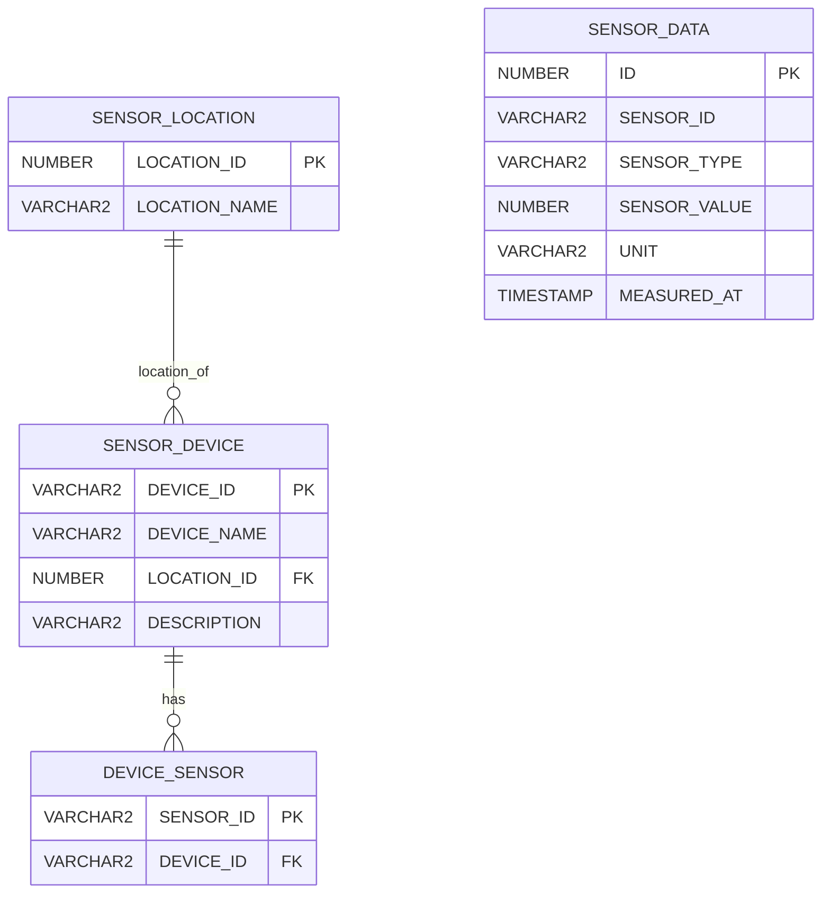

# デバイス管理の設計（登録・一覧・詳細・変更・削除・センサー関連付け）

> **作業名の確認：** [タスク早見表](../タスク早見表.md)（D0・B1・A1などの記号と担当機能の対応）

## 基本構成

- 設置場所マスタ・デバイス登録／一覧（C1）～デバイス削除（C4）は独立したデバイス管理機能。設置場所マスタ・デバイス登録／一覧（C1）でマスタデータを取得してデバイスを登録し、一覧で確認できる状態まで完成させる。
- デバイスとセンサーの関連付け（C5）でセンサーIDとデバイスIDの対応を追加する。**デバイスとセンサーの関連付け（C5）は設置場所マスタ・デバイス登録／一覧（C1）と測定日時範囲検索（B2）の完成だけで着手可能**。デバイス詳細表示（C2）～デバイス削除（C4）は不要。
- デバイスIDとセンサーIDは別。1台に複数のセンサーID、1つのセンサーIDに対して1台のデバイスを想定する。
- 設置場所検索（B3）では、デバイスとセンサーの関連付け（C5）の関連情報と現在の設置場所マスタを利用して検索する。設置履歴は管理しない。

## Oracleデータモデル



`DEVICE_SENSOR.SENSOR_ID`と`SENSOR_DATA.SENSOR_ID`の関係は値による照合であり、外部キーは設けない。MQTT受信時に未登録センサーのデータも保存できる。

### 設置場所マスタ・デバイス登録／一覧（C1）：DDL例

```sql
CREATE TABLE SENSOR_LOCATION (
    LOCATION_ID NUMBER GENERATED BY DEFAULT AS IDENTITY PRIMARY KEY,
    LOCATION_NAME VARCHAR2(100) NOT NULL UNIQUE
);
CREATE TABLE SENSOR_DEVICE (
    DEVICE_ID VARCHAR2(50) PRIMARY KEY,
    DEVICE_NAME VARCHAR2(100) NOT NULL,
    LOCATION_ID NUMBER NOT NULL REFERENCES SENSOR_LOCATION(LOCATION_ID),
    DESCRIPTION VARCHAR2(300)
);
INSERT INTO SENSOR_LOCATION (LOCATION_NAME) VALUES ('実習室A');
INSERT INTO SENSOR_LOCATION (LOCATION_NAME) VALUES ('実習室B');
COMMIT;
```

### デバイスとセンサーの関連付け（C5）：DDL例

```sql
CREATE TABLE DEVICE_SENSOR (
    SENSOR_ID VARCHAR2(50) PRIMARY KEY,
    DEVICE_ID VARCHAR2(50) NOT NULL REFERENCES SENSOR_DEVICE(DEVICE_ID)
);
```

## REST API（開発段階ごと）

| 段階 | API | 入力／期待結果 |
|---|---|---|
| 設置場所マスタ・デバイス登録／一覧（C1） | `GET /api/locations` | 場所ID・場所名の一覧 |
| 設置場所マスタ・デバイス登録／一覧（C1） | `GET /api/devices` | デバイス一覧（ID・名前・場所名・説明） |
| 設置場所マスタ・デバイス登録／一覧（C1） | `POST /api/devices` | デバイスID・名称・場所ID・説明を登録（201） |
| デバイス詳細表示（C2） | `GET /api/devices/{deviceId}` | 詳細表示（200／404） |
| デバイス情報更新（C3） | `PUT /api/devices/{deviceId}` | 名前・場所・説明を変更（200） |
| デバイス削除（C4） | `DELETE /api/devices/{deviceId}` | 削除（204／404） |
| デバイスとセンサーの関連付け（C5） | `GET /api/devices/{deviceId}/sensors` | 関連センサーID一覧 |
| デバイスとセンサーの関連付け（C5） | `POST /api/devices/{deviceId}/sensors` | `{sensorId}`を登録（201） |
| デバイスとセンサーの関連付け（C5） | `DELETE /api/devices/{deviceId}/sensors/{sensorId}` | 関連を解除（204） |
| デバイスとセンサーの関連付け（C5） | **`GET /api/devices/{deviceId}/data?limit=100`** | 当該デバイスに関連するセンサーの測定データを取得（JSON配列） |

デバイスとセンサーの関連付け（C5）のデバイス別データ取得は内部的に`DEVICE_SENSOR`から`sensorId`を解決し、`SENSOR_DATA`と照合する。公開のセンサーID検索機能を前提にしない。検索対象の`SENSOR_DATA`自体にはデバイスIDを追加しない。

## 各段階の画面・完了条件

| Task | 完成条件 |
|---|---|
| 設置場所マスタ・デバイス登録／一覧（C1） | `devices.html`で場所を選択してデバイス登録し、一覧で確認できる |
| デバイス詳細表示（C2） | 1台の詳細情報を表示。存在しないIDはメッセージ表示 |
| デバイス情報更新（C3） | デバイス名・場所・説明を更新し、画面へ反映。IDは変更不可 |
| デバイス削除（C4） | 対象を確認して削除し、一覧から消える |
| デバイスとセンサーの関連付け（C5） | 関連センサーIDの割当／解除と、そのデバイスの測定データ一覧が表示できる |

## 追加ソース案

`model/SensorDevice.java`、`model/SensorLocation.java`、デバイスとセンサーの関連付け（C5）で`model/DeviceSensor.java`、`repository/SensorDeviceRepository.java`・`repository/JdbcSensorDeviceRepository.java`、`service/SensorDeviceService.java`、`resource/SensorDeviceResource.java`・`resource/SensorLocationResource.java`、`devices.html`、`js/device-api.js`、`js/devices.js`、`db/schema-device.sql`。

**デバイスとセンサーの関連付け（C5）のデバイス別測定データ**は、`SensorDeviceResource`から`SensorDataService`等に追加するデバイス用の検索処理を呼ぶ構成とし、SQLは既存の`JdbcSensorDataRepository`の責務とする。既存のSensorDataRepositoryにデバイスCRUDを混ぜない。

## 制約・テスト

- 設置場所のCRUDは実装せずSQLで初期投入。場所を選択するフォームは設置場所マスタ・デバイス登録／一覧（C1）で完成。
- デバイスとセンサーの関連付け（C5）に到達した後のデバイス削除では、関連を先に解除する。デバイス削除（C4）自体のAPIはデバイスに関連があるときDB制約違反を返し得るため、画面に関連解除を促す簡単な案内を設ける。
- `SENSOR_DATA`を変更せず、古いデータも`SENSOR_ID`から対応付ける。場所変更後は過去データの検索上の場所も変更される。
- ユーザー認証・デバイス状態監視・履歴管理・移設履歴・複雑な例外階層を扱わない。
- 各段階でCDI・JUnit/Mockito・実Oracle・ブラウザを必要な範囲で確認する。
