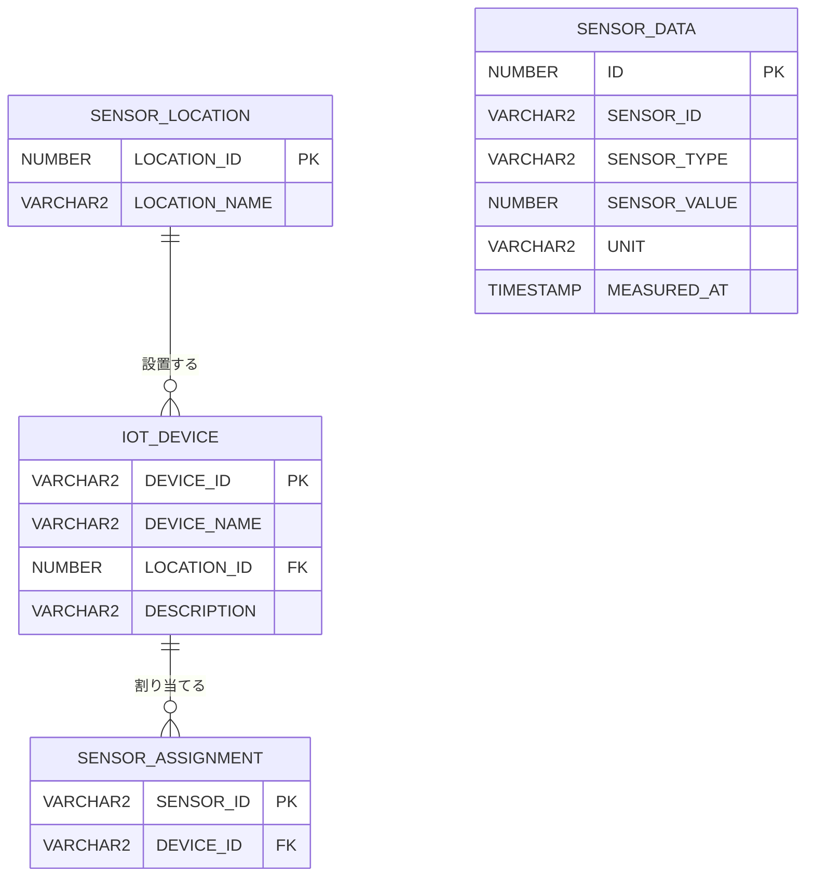

# デバイス管理：設計

## 管理対象と関係

デバイスIDとセンサーIDは**別の識別子**です。1台のデバイスには複数のセンサーを割り当てられますが、同じセンサーIDを複数のデバイスに割り当てることはできません。設置場所はマスタから選択します。

| テーブル | 役割 | 作成する段階 |
|---|---|---|
| `SENSOR_LOCATION` | 設置場所のマスタ | デバイス登録・一覧（C1） |
| `IOT_DEVICE` | デバイス本体の登録情報 | デバイス登録・一覧（C1） |
| `SENSOR_ASSIGNMENT` | センサーIDとデバイスIDの割当関係 | センサー関連付け（C5） |
| `SENSOR_DATA` | 既存の測定データ。構造は変更しない | 現行版で作成済み |

- `LOCATION_NAME`と`DEVICE_NAME`は必須、`DESCRIPTION`は任意。デバイスIDは登録後に変更しない。
- 場所IDは数値、デバイスID・センサーIDは文字列。名称は100文字以内、デバイスID・センサーIDは50文字以内、説明は300文字以内を目安とする。
- 設置場所は初期データを登録して使用し、**場所自体の登録・更新・削除画面は作らない**。
- `SENSOR_ASSIGNMENT.SENSOR_ID`は一意で、対応する`IOT_DEVICE.DEVICE_ID`を参照する。
- `SENSOR_DATA.SENSOR_ID`から`SENSOR_ASSIGNMENT.SENSOR_ID`へは値で照合し、外部キーを設けない。未登録センサーからのMQTTデータも保存できる。
- 設置場所はデバイスの現在の登録場所とし、移設履歴は記録しない。

テーブル作成・検索・登録・更新・削除の**SQL文は実装担当者が作成する**。

## REST API

| 課題 | メソッドとURL | 内容 |
|---|---|---|
| C1 | `GET /api/locations` | 場所ID・名称の一覧 |
| C1 | `GET /api/devices` | デバイスID・名称・場所・説明の一覧 |
| C1 | `POST /api/devices` | デバイス登録。成功時201 |
| C2 | `GET /api/devices/{deviceId}` | 1台の詳細。存在しなければ404 |
| C3 | `PUT /api/devices/{deviceId}` | 名称・場所・説明を更新。IDは不変 |
| C4 | `DELETE /api/devices/{deviceId}` | 削除。成功時204 |
| C5 | `GET /api/devices/{deviceId}/sensors` | 割当済みセンサーID一覧 |
| C5 | `POST /api/devices/{deviceId}/sensors` | センサーIDを割り当てる。成功時201 |
| C5 | `DELETE /api/devices/{deviceId}/sensors/{sensorId}` | 割当を解除する。成功時204 |
| C5 | `GET /api/devices/{deviceId}/data?limit=100` | 割当済みセンサーの測定データ一覧 |

登録時はデバイスID・名称・場所ID・説明を渡す。関連付けのPOSTではセンサーIDを渡す。既存の測定データを変更せずに、割当済みのセンサーIDを手掛かりにデータを取得する。

## 画面とソース構成

- `devices.html`で場所を選択して登録し、一覧表示する（C1）。詳細・更新・削除は後続課題で追加する。
- C5では割当・解除の操作と、デバイス別測定データの閲覧を追加する。
- Javaでは`SensorDevice`、`SensorLocation`等のモデル、デバイス管理用Resource・Service・Repositoryを新設する。C5の測定データ取得は既存のセンサーデータ側Repositoryに実装する。
- デバイスにセンサーが割り当てられた状態で削除する場合は、先に割当を解除するよう画面に案内する。
