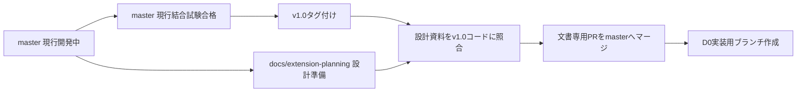

# 準備用ブランチ・Issue・Milestone運用

## マージ時期



1. 教員が`master`から`docs/extension-planning`を作成し、`docs/extensions/`のみ編集。
2. 必要ならDraft PRを作り、現行開発中は**マージしない**。
3. 現行版の結合試験に合格して`master`に`v1.0`タグを付ける。
4. 準備ブランチへ最新`master`を取り込み、ソースと資料の差を確認する。
5. 文書専用PRをマージし、準備ブランチを削除する。
6. 最新`master`から`feature/d0-oracle-only`等を作成し、通常のIssue単位のPRで実装する。

**注意**：準備ブランチを`master`へマージしない限り設計書は`v1.0`タグに含まれない。資料の更新が多い場合はDraft PRで差分を見える化する。

## GitHub Project

- `Extension Backlog`ビューを設け、現行版のBoardと混在させない。
- Issueの`Status`（Todo / In Progress / Review / Done）、`Assignees`、`Estimate (h)`を使用。
- ラベル：`enhancement`、`area:search`、`area:graph`、`area:device`、`area:infra`。
- 現行開発中はDraft IssueかMarkdownのIssue原稿を用意。**IssueのGitHub番号は実際に登録してから確定**する。原稿ではD0、B1～B4などのTask IDで参照する。

## Milestoneとは

リポジトリ単位で複数のIssue／PRを**目標としてまとめる**GitHubの機能。Projectの状態管理とは別物。完了率はIssue／PRのクローズ数を示すもので、機能の実動作を証明しない。

| 推奨Milestone | 含めるTask | 完了条件 |
|---|---|---|
| E0 Oracle専用化 | D0 | Oracle環境で既存機能の回帰試験合格 |
| E1 センサー種別検索 | B1 | API＋画面＋テスト完了 |
| E2 センサーID検索 | B2 | 単独検索・種別とのAND完了 |
| E3 基本折れ線グラフ | A1 | 1系列グラフが使える |
| E4 グラフ絞り込み | A2、A3 | 種別／ID切替を実装・確認 |
| E5 高度検索 | B3、B4 | 日時・複合条件の検索と画面 |
| E6 表示改善 | A4 | 表・グラフの切替と回帰確認 |
| E7 デバイス登録・一覧 | C1 | 位置マスタ＋DB＋API＋画面が動作 |
| E8 デバイス詳細 | C2 | 詳細表示が動作 |
| E9 デバイス編集 | C3 | 更新が動作 |
| E10 デバイス削除 | C4 | 削除が動作 |
| E11 センサー関連付け | C5 | 関連付け・測定値参照が動作 |

**推奨：** 途中でやめられる境界を明確にするため、1つのMilestoneはできるだけ1つの動作完成段階に対応させる。期限は未定のままでよい。

## PRテンプレートへの追記案（追加課題のPRのみ）

```markdown
- 対応Task：B1 など
- 動作確認：API / Oracle / Webのうち該当する項目
- JUnit実行結果：
- 既存API・画面の回帰確認：
- 完成Milestone：
```

## 起票のタイミング

現在：Issue原稿と見積もりを保管。現行版完成後：設計を再点検。追加課題の実施範囲決定後：必要なIssueだけ起票してMilestoneへ登録し、担当を割り当てる。
