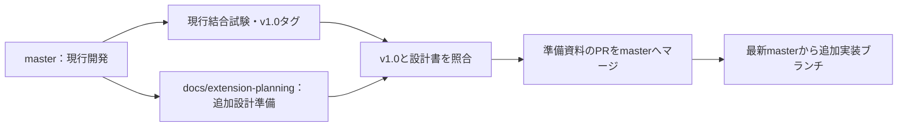

# 準備用ブランチ・Issue・Milestone運用

> **作業名の確認：** [タスク早見表](../タスク早見表.md)（D0・B1・A1などの記号と担当機能の対応）

## 作成とマージの順序

1. 教員が`docs/extension-planning`で`docs/extensions/`の設計書・Issue原稿・テスト仕様を作る。
2. 必要ならDraft PRを作り、現行開発中は**マージしない**。
3. 現行版の結合試験に合格し、`master`へ`v1.0`タグを作成する。
4. 準備ブランチに最新`master`を取り込んで設計の差分を見直す。
5. 設計資料だけPRマージした後、必要なTaskの実装ブランチを作る。

## Project

現行開発と混ざらないよう`Extension Backlog`ビューを用意。`Estimate (h)`はNumber型のユーザー作成フィールド。ラベルは`enhancement`、`area:search`、`area:graph`、`area:device`、`area:infra`。未実施のTaskは原稿またはDraft Issueとして保存する。

## Milestone（完成段階を管理する）

| Milestone | 対応Task | 完成ゲート |
|---|---|---|
| Oracle専用化 | Oracle専用化（D0） | Oracleで既存機能の回帰試験に合格 |
| 種別検索 | センサー種別検索（B1） | API・画面・テスト合格 |
| 期間検索 | 測定日時範囲検索（B2） | 期間単独・種別とのAND合格 |
| 基本グラフ | 基本折れ線グラフ（A1） | 折れ線表示・0件対応 |
| 種別切替 | グラフ種別切替（A2） | 種別選択でAPI再取得・表示更新 |
| グラフ期間指定 | グラフの測定期間指定（A3） | 開始／終了指定をグラフへ反映 |
| 表示改善 | 表とグラフの表示改善（A4） | 表とグラフの整合確認 |
| デバイス登録・一覧 | 設置場所マスタ・デバイス登録／一覧（C1） | 場所選択・登録・一覧が動く |
| デバイス詳細 | デバイス詳細表示（C2） | 詳細取得が動く |
| デバイス更新 | デバイス情報更新（C3） | 更新が動く |
| デバイス削除 | デバイス削除（C4） | 削除が動く |
| センサー関連付け | デバイスとセンサーの関連付け（C5） | 割当／解除・デバイス別測定値閲覧 |
| 設置場所検索 | 設置場所検索（B3） | 場所単独／種別／期間とのANDが動く |

Milestoneは作業を閉じた数で進捗を表す。**Issueを閉じただけでは完了としない**。その段階のHTTP・DB・画面と回帰テストの結果を確認してから達成判定する。残り時間は不明なので期限は空欄でよい。

## PR記録項目

- 対応TaskとMilestone
- 主なソース・API・SQL変更
- JUnit／Mockito／Quarkus試験結果
- 実Oracle・ブラウザでの結果
- 既存一覧・MQTT登録の回帰結果

**注意：** 追加の設計書やIssueがGitHub上に存在していても、機能実装済みとはみなさない。現行版の完成タグには、追加課題の準備資料を含めない。
