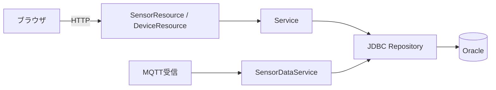

# 追加開発の共通設計方針

## 現行ソースとの対応

現行完成版の主要構成：`SensorResource` → `SensorDataService` → `SensorDataRepository` → `JdbcSensorDataRepository` → Oracle。`SensorData`は`(sensorId, sensorType, value, unit, measuredAt)`のrecordであり、デバイスIDは持たない。Webは`index.html`、`js/script.js`、`js/sensor-api.js`。Oracleの`SENSOR_DATA`には`ID`（identity PK）がある。

追加機能は既存の層を維持し、新しいクラス・画面を必要な部分に限定して増やす。依存ライブラリ・フレームワークの追加はChart.jsのみを基本とする。

## IDの扱い

- **`sensorId`**：測定データの送信元センサーの識別子。既存の`SENSOR_DATA.SENSOR_ID`とMQTT JSONを**変更しない**。
- **`deviceId`**：筐体・機器の識別子。C1で新規作成する`SENSOR_DEVICE.DEVICE_ID`。
- 1台のデバイスに複数のセンサーIDを関連付けられる。1つのセンサーIDは同時に1つのデバイスにのみ割り当てる想定。
- C1～C4は**デバイスとセンサーの対応付けを行わない**。C5で`DEVICE_SENSOR`対応表を作り、既存のセンサーデータをsensorIdで検索する。
- センサーデータへの外部キー追加やMQTT JSONへのdeviceId追加は**しない**。過去データもそのまま使える。

## 既存仕様との互換性

- `GET /api/sensors?limit=100`は従来と同じ動作。条件未指定は全データ、最新順、件数は1～1000。
- 検索条件は任意、複数条件はAND。**絞り込み→日時降順→件数制限**の順で処理する（SQLの内側で条件・ORDER BYを適用し、外側でROWNUM制限）。
- `measuredAt`はローカル日時文字列`yyyy-MM-ddTHH:mm:ss`を使用。日時は**開始以上／終了未満**に統一。時刻帯の変換は扱わない（訓練用）。
- `SensorType`の既存値 `TEMPERATURE`、`HUMIDITY`、`ILLUMINANCE`のみを対象とする。
- 既存画面では取得件数・一覧表・エラー表示を残す。
- CSVクラス本体は削除せず、Oracle専用化後は実行経路から外す。`StorageType`は他の参照がなくなれば削除可。

## 設置場所マスタ

- C1から`SENSOR_LOCATION(LOCATION_ID, LOCATION_NAME)`を使用する。
- 初期段階ではDB作成SQLで例示レコードを投入。画面からの設置場所追加・更新・削除は実装しない。
- デバイス登録／更新画面ではマスタ一覧を取得して選択肢を表示。`SENSOR_DEVICE.LOCATION_ID`が外部キー。

## シンプルな構造

追加デバイス管理は`SensorDeviceResource`、`SensorDeviceService`、`SensorDeviceRepository`、`JdbcSensorDeviceRepository`などの分離を基本とする。デバイス管理に必要なCDI定義だけを追加する。`SensorDataRepository`の責務にデバイスCRUDを混ぜない。

## エラー処理を簡素化するルール

- Javaの入力チェック：必須値、数値範囲、日時の前後関係のみ。
- API正常時はGET 200、POST 201、PUT 200、DELETE 204。未存在は404、不正入力は400を基本とする。初学者向けに複雑なエラーコード体系は採用しない。
- 例外は既存の`GlobalExceptionMappers`の方針を尊重し、必要最低限を追加する。
- 認証・認可、ページネーション、楽観ロック、複数テーブルをまたぐ高度なトランザクション制御、監査履歴、マスタCRUD、自動テストのための新しい基盤導入は対象外。
- JavaのCDI管理対象は`@QuarkusTest`で注入して検証する現行の後続方針に合わせる。Resourceの単体テストはCDIから取得後に**メソッド直接呼び出し**、HTTP応答の実地確認は結合試験と分ける。実Oracle SQLは結合試験で確認する。

## 設計の暫定事項

C5の「同一センサーIDは1デバイスに対応」は指導の複雑化を避けるための設計案。`v1.0`完成時に既存MQTT発行元のセンサーIDの粒度を再確認する。Chart.jsの採用版・ライセンス文書・オフライン配布方法も着手直前に確認する。
