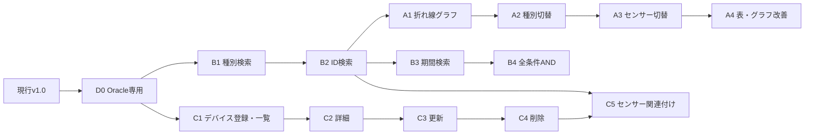

# 追加開発計画・開発順序

## 目的・原則

現行のセンサー収集・保存・REST・一覧表示を保ち、Oracle専用化後に検索、折れ線グラフ、デバイス管理を追加する。残り時間が未定のため、**段階（縦切り）ごとに必ず使える状態を完成**する。下位レイヤーだけの完成を機能完成としない。

## 推奨順序・依存関係

※検索B3/B4とグラフA4、デバイス管理C系統は時間・担当に応じて別の順序で実施してよい。**同時に複数の未完成縦切りを抱えない**ことを優先する。

## 完成段階と所要工数（実装・テスト・修正・PRの合計、人時）

| 段階 | 確認できる完成成果 | 目安 | 前提 | 必須 |
|---|---|---:|---|---|
| D0 | Oracleで従来のMQTT→保存→一覧が動作。CSVコードは残るが選択できない | 5～9 | v1.0 | ○ |
| B1 | センサー種別を指定して一覧検索 | 7～12 | D0 | 推奨 |
| B2 | センサーIDを指定して一覧検索。種別とIDはAND | 5～9 | B1 | 推奨 |
| A1 | 取得データから1系列の折れ線グラフを表示 | 5～9 | B2 | 推奨 |
| A2 | 種別選択に応じてグラフを更新 | 2～4 | A1 | 任意 |
| A3 | センサーID選択に応じてグラフを更新 | 2～4 | A2 | 任意 |
| B3 | 開始・終了日時で単独の期間検索を一覧に反映 | 8～13 | B2 | 任意 |
| B4 | 種別・ID・期間の全条件AND検索 | 4～8 | B3 | 任意 |
| A4 | 表・グラフの切替／併記と表示整理 | 3～5 | A3 | 任意 |
| C1 | 設置場所マスタ選択でデバイスを登録し、一覧表示 | 16～25 | D0 | 任意 |
| C2 | デバイスの詳細を1件表示 | 4～7 | C1 | 任意 |
| C3 | デバイス名・設置場所・説明の更新 | 7～11 | C2 | 任意 |
| C4 | デバイスの削除と一覧再表示 | 5～9 | C3 | 任意 |
| C5 | デバイスへセンサーIDを関連付け、その測定データを参照 | 8～14 | C4、B2 | 任意 |

**すべての概算合計：81～139人時。** 既存コードの理解、設計変更、Oracle環境の調整で増減する。学習・講習時間や大幅な仕様変更は含まない。人時と50分コマは混同しない。

## 完成判定のゲート

1. 既存機能（MQTT登録、センサー一覧GET、Web表示）を壊していない。
2. 対応する新しい入力がAPI／DB／画面の必要箇所で動作する。**C1は独立したDB・API・画面**で合格でき、C5を待たない。
3. JUnit／Mockitoで必要なロジックを確認し、実際のQuarkus・Oracle・ブラウザで最低1回正常動作を確認する。
4. 試験結果をIssueまたはPRへ記載し、レビューを経て`master`にマージする。
5. マージ後に当該段階のMilestoneをクローズする。未着手の次段階に依存しない。

## 途中終了の判断

実習残り時間が次段階の見積（上限側）に満たない場合は開始しない。進行中の段階で期間終了となりそうな場合は、その段階のPRを未マージのまま保留し、直近の完成Milestoneまでを成果とする。
