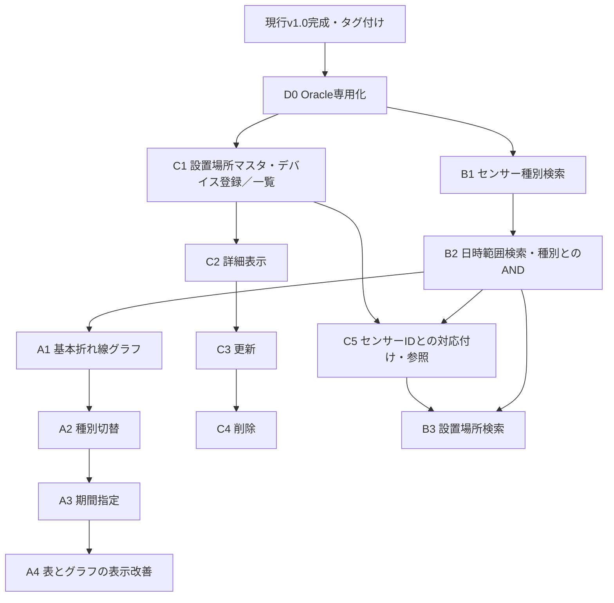

# 追加開発計画・開発順序

> **作業名の確認：** [タスク早見表](タスク早見表.md)（D0・B1・A1などの記号と担当機能の対応）

## 基本方針

- 現行版が完成して`v1.0`タグを付けた**後**に、追加課題の資料だけを`master`に取り込み、追加実装を始める。
- 各TaskでAPI・DB・画面までを必要に応じて接続し、**そこで終了しても利用できる完成状態**を残す。未完成機能を`master`へマージしない。
- 追加版ではOracleのみを使用する。CSV用クラスは参考資料としてソースに残すが、Repository切替機能は廃止する。
- 一般利用者向けのセンサーID検索を新規機能として設けない。内部識別子としての`sensorId`は維持する。
- 日時は開始以上・終了未満、条件はすべて任意・AND。設置場所検索の着手には**設置場所マスタ・デバイス登録／一覧（C1）とデバイスとセンサーの関連付け（C5）の完成**が必要。

## 開発依存関係

**重要：** デバイスとセンサーの関連付け（C5）は、デバイス登録・一覧（C1）と測定日時範囲検索（B2）が完成すれば着手できる。デバイスの詳細・更新・削除（C2～C4）は前提としない。関連付け後にデバイスを削除するときは、関連を先に解除する。

## 段階別の完成形と工数（人時）

| Task | 利用者ができること | 前提 | 概算工数 |
|---|---|---|---:|
| Oracle専用化（D0） | OracleでMQTT受信・保存・REST一覧が動く | v1.0 | 5～9 |
| センサー種別検索（B1） | センサー種別を選んで一覧表示 | Oracle専用化（D0） | 7～12 |
| 測定日時範囲検索（B2） | 測定期間を指定、種別とのAND検索も可能 | センサー種別検索（B1） | 10～15 |
| 基本折れ線グラフ（A1） | 取得したデータを折れ線で表示 | 測定日時範囲検索（B2） | 5～9 |
| グラフ種別切替（A2） | センサー種別の変更に応じてグラフ更新 | 基本折れ線グラフ（A1） | 2～4 |
| グラフの測定期間指定（A3） | 期間指定に応じてグラフ更新 | グラフ種別切替（A2） | 2～4 |
| 表とグラフの表示改善（A4） | 一覧とグラフを切替・併記 | グラフの測定期間指定（A3） | 3～5 |
| 設置場所マスタ・デバイス登録／一覧（C1） | 設置場所を選んでデバイス登録・一覧 | Oracle専用化（D0） | 16～25 |
| デバイス詳細表示（C2） | デバイス詳細を表示 | 設置場所マスタ・デバイス登録／一覧（C1） | 4～7 |
| デバイス情報更新（C3） | デバイス情報を変更 | デバイス詳細表示（C2） | 7～11 |
| デバイス削除（C4） | デバイスを削除 | デバイス情報更新（C3） | 5～9 |
| デバイスとセンサーの関連付け（C5） | デバイスへセンサーIDを割り当て、測定データを閲覧 | 設置場所マスタ・デバイス登録／一覧（C1）、測定日時範囲検索（B2） | 10～16 |
| 設置場所検索（B3） | 設置場所で測定データを絞り込み、種別・期間とのAND検索が可能 | デバイスとセンサーの関連付け（C5）、測定日時範囲検索（B2） | 10～16 |

**全13段階の合計目安：86～142人時。** 実装・テスト・軽微な修正・PRを含む概算。講習・新規環境構築は別。

## 完成ゲート

1. 追加した機能が実Oracle・REST API・ブラウザで、必要な範囲を通して動作する。
2. 検索条件未指定の`GET /api/sensors?limit=100`を壊していない。
3. センサー種別検索（B1）/測定日時範囲検索（B2）/設置場所検索（B3）の該当条件を組み合わせても正しくAND検索でき、結果を日時降順に並べた**後**に件数を制限する。
4. JUnit・Mockito（該当するクラス）、Quarkus起動によるCDIテスト、手動結合テストを行い、PRに結果を記す。
5. レビュー後に`master`へマージし、対応Milestoneの完了を確認する。

## 途中終了への対応

設置場所検索（B3）に着手しなければ設置場所検索は使えないが、設置場所マスタ・デバイス登録／一覧（C1）～デバイスとセンサーの関連付け（C5）で完成済みのデバイス機能は独立して利用できる。測定日時範囲検索（B2）とグラフの測定期間指定（A3）が完成していれば、センサーIDを入力させずに**種別と期間を用いた一覧・グラフ**が利用できる。次段階の見積工数に余裕がないときは着手せず、完成済みMilestoneを成果とする。
