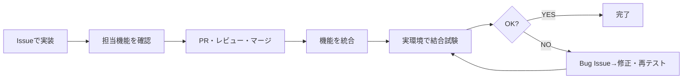

# テストの進め方と仕様書一覧

## 1. いつ何を確認するか



| 対象 | 担当機能の試験（PR前） | 結合試験（統合後） |
|---|---|---|
| Java：Repository共通、JDBC、Service、Producer、REST | **JUnit 5 + Mockito**：実DB・MQTTなしで単体試験 | OracleとのSQL実行、HTTP応答、実構成の動作を確認 |
| MQTT受信 | コードレビュー（受信処理・Executor・終了処理） | **実Brokerに接続して試験**（JUnit/Mockitoを使わない） |
| Web JavaScript | ブラウザから**手動試験**（必要なら開発者ツールで確認） | 実APIと連携した画面試験 |
| Oracleテーブル作成SQL | SQL文レビュー | **実OracleでDDL実行**（単体試験に置き換えない） |

**JUnitのテストコード**：`src/test/java/`。`@Disabled("TODO")` が付いたテストは実行されません。テスト内容を完成させてから、そのテストの `@Disabled` を取り除いてください。**未実行のテストをOKと報告しないこと。**

**実施結果**：各IssueまたはPRに「テストID・環境・実際の結果・OK/NG/保留・再実施結果」を記録。[GitHub運用ルール](../GitHubチーム開発_運用ルール・操作手順.md#6-テスト仕様書とテスト結果)を参照。

## 2. テスト仕様書

| 仕様書 | 方法 | 実施タイミング |
|---|---|---|
| [Test_01](Test_01.md) Repository共通 | JUnit | PR前 |
| [Test_02](Test_02.md) JDBC登録 | @QuarkusTest＋Mockito | PR前 |
| [Test_03](Test_03.md) JDBC取得 | @QuarkusTest＋Mockito | PR前 |
| [Test_04](Test_04.md) Service | @QuarkusTest＋Mockito | PR前 |
| [Test_05](Test_05.md) Producer | @QuarkusTest＋Mockito | PR前 |
| [Test_06](Test_06.md) REST | @QuarkusTest＋Mockito | PR前 |
| [Test_07](Test_07.md) MQTT | 実Broker・手動 | 統合後 |
| [Test_08](Test_08.md) API通信JS | ブラウザ・開発者ツール | ブラウザ実行時 |
| [Test_09](Test_09.md) Web表示 | ブラウザ・手動 | ブラウザ実行時 |
| [Test_10](Test_10.md) 全体結合 | Oracle・MQTT・ブラウザ | 統合後 |
| [Test_11](Test_11.md) Oracle DDL | Oracleで手動 | JDBCの実DB結合前 |

※ 既存のテスト仕様書に用意されているテストケースに不具合や不足があると判断される場合は、指導員に相談の上でテスト仕様書およびテストプログラムを修正する。

## 3. JUnitの実行方法

- **Eclipse**：対象のテストクラスを右クリック → **Run As → JUnit Test**。赤が失敗、緑が成功。Skipped（無効化）は成功件数に含めない。
- **Maven**：`mvn test`。特定クラスは `mvn -Dtest=SensorDataServiceTest test`。
- Mockitoで作った `DataSource` や `Repository` は**実際にはDBへアクセスしない**。SQL文法、DB制約、QuarkusのHTTP応答は別途結合試験で確認する。
- **テスト起動方式の使い分け**：`SensorDataService`・`RepositoryProducer`・`SensorResource` は `@QuarkusTest` でQuarkus/CDIを起動する。`AbstractSensorDataRepository`・`JdbcSensorDataRepository` はCDI管理外なので普通のJUnitで確認する。`SensorResource` はCDIから注入した実体のメソッドを直接呼び、HTTPリクエストは送らない。HTTP経由の確認は結合試験で実施する。
- `@InjectMock` は依存先だけをモック化する。テスト対象自身は `@Inject` で取得する。
- テスト用の `CsvStorageProfile` はCSV方式・MQTT無効を設定し、実Oracle/Brokerに依存せずにQuarkusを起動する。`JdbcStorageProfile` は保存先選択だけを確認し、SQLは実行しない。

## 4. 試験用データの共通例

```json
{"sensorId":"TRAIN-01","sensorType":"TEMPERATURE","value":23.5,"unit":"C","measuredAt":"2026-11-20T10:00:00"}
```

- MQTT通信およびREST API通信で送受信するJSONデータの例は上記の通り。
- 結合試験環境では、5秒間隔でMQTT Brokerへセンサーデータ（ダミー）を送信するプログラムが常時起動している。
